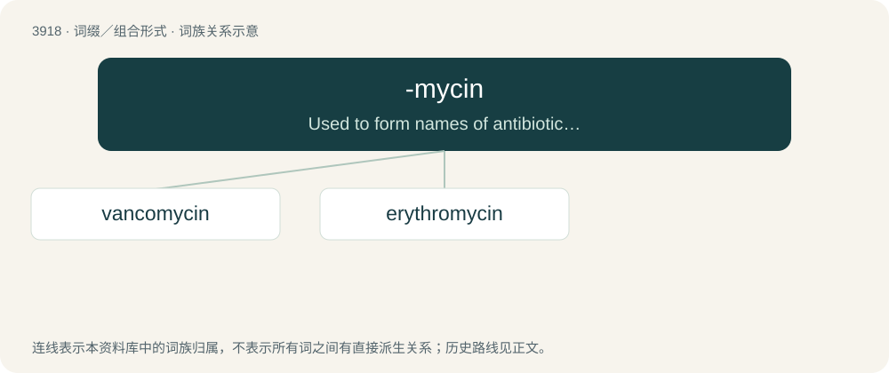

# 3946 · -mycin — Used to form names of antibiotics produced by Streptomyces strains.

[总目录](../00_总目录_按常用程度.md)

**类型**：词缀／组合形式　｜　**来源语言**：见词源记录

## 核心含义与来源

- 核心含义：Used to form names of antibiotics produced by Streptomyces strains.
- 英文含义：Used to form names of antibiotics produced by Streptomyces strains.
- 词形：-mycin

**多个词源／构词路径**：同一拼写可能有不同来源；以下按词性和含义分别列出。

**来源记录 1**（后缀／后置成分；Used to form names of antibiotics produced by Streptomyces strains.）

From streptomycin.

**来源记录 2**（后缀／后置成分；Used to form names of antibiotics that pertain to fungi）

From Ancient Greek μύκης (múkēs, “fungus”).

## 词族图

## 单词速览（常用到不常用）

| 单词 | 音标 | 释义 |
|---|---|---|
| [vancomycin](#w-1) | /ˌvæŋ.kəˈmaɪ.sɪn/ | \[化\] 万古霉素；\[医\] 万古霉素 |
| [erythromycin](#w-2) | 英 /ɪˌɹɪθ.ɹə(ʊ)ˈmʌɪ.sɪn/；美 /ɪˌɹɪθ.ɹəˈmaɪ.sn̩/ | n. 红霉素；\[化\] 红霉素 |

## 逐词详解

### 1. vancomycin

**词性**：名词　｜　**音标**：/ˌvæŋ.kəˈmaɪ.sɪn/

**中文释义**：\[化\] 万古霉素；\[医\] 万古霉素

**英文义项**：A glycopeptide antibiotic C₆₆H₇₅Cl₂N₉O₂₄ produced by the actinomycete Amycolaptosis orientalis, used in the form of its hydrochloride C₆₆H₇₅Cl₂N₉O₂₄·HCl against Gram-positive bacteria, especially staphylococci resistant to meticillin and enterococci.

**构词拆分**：vanquish + -o- + -mycin

**词源与演化**：

From vanquish + -o- + -mycin (“antibiotic produced by a Streptomyces strain”).

### 2. erythromycin

**词性**：名词　｜　**音标**：英 /ɪˌɹɪθ.ɹə(ʊ)ˈmʌɪ.sɪn/；美 /ɪˌɹɪθ.ɹəˈmaɪ.sn̩/

**中文释义**：n. 红霉素；\[化\] 红霉素

**英文义项**：An antibiotic similar to penicillin, used for the treatment of a number of bacterial infections. / A broad-spectrum macrolide antibiotic C₃₇H₆₇NO₁₃ produced by an actinomycete Saccharopolyspora erythraea (formerly Streptomyces erythreus) and similar in its effects to penicillin, administered orally or topically in the treatment of infections caused by Gram-positive bacteria.

**构词拆分**：-o- + -mycin

**词源与演化**：

From (Streptomyces) erythr(eus) + -o- + -mycin (“antibiotic from a Streptomyces strain”).
