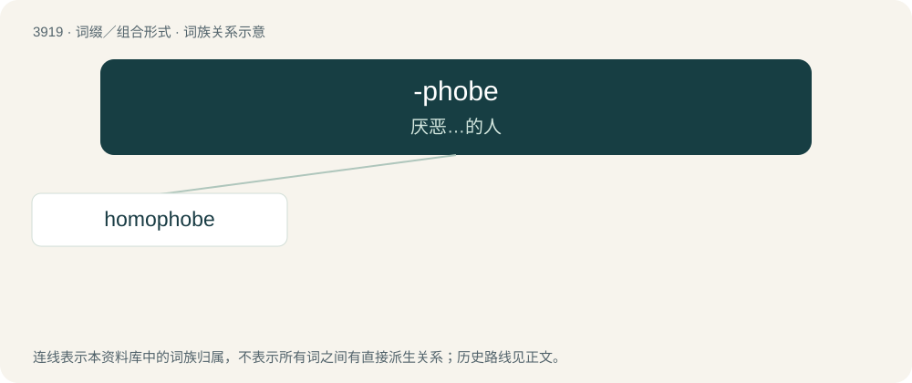

# 3947 · -phobe — 厌恶…的人

[总目录](../00_总目录_按常用程度.md)

**类型**：词缀／组合形式　｜　**来源语言**：见词源记录

## 核心含义与来源

- 核心含义：厌恶…的人
- 英文含义：Used to form nouns denoting a person having a fear of a specific thing.
- 词形：-phobe

**来源记录 1**（后缀／后置成分；Used to form nouns denoting a person having a fear of a specific thing.）

From French -phobe, from Latin -phobus, from Attic Greek -φόβος (-phóbos), combining form of φόβος (phóbos), ablaut variant of φέβεσθαι (phébesthai), middle infinitive of φέβομαι (phébomai), from Proto-Indo-European \*bʰegʷ-. Cognates include Russian бегать (begatʹ, “run, flee”), Slovak bežať (“run”), Polish biec (“run”), Lithuanian bėgti (“run”), Albanian dëboj (“throw out, drive away, expel, banish”). Compare German -phob.

## 词族图

## 单词速览（常用到不常用）

| 单词 | 音标 | 释义 |
|---|---|---|
| [homophobe](#w-1) | 英 /ˈhəʊ.məˌfəʊb/；美 /ˈhoʊ.məˌfoʊb/ | n. 憎恶同性恋的人 |

## 逐词详解

### 1. homophobe

**词性**：名词　｜　**音标**：英 /ˈhəʊ.məˌfəʊb/；美 /ˈhoʊ.məˌfoʊb/

**中文释义**：n. 憎恶同性恋的人

**英文义项**：One who is prejudiced against homosexual people, or LGBTQ people in general; one who exhibits homophobia.

**构词拆分**：homo- + -phobe

**词源与演化**：

Back-formation from homophobia, equivalent to homo- + -phobe (notice in Greek it would refer to a self-hater).

**例句**：

> His father is a raging homophobe.
