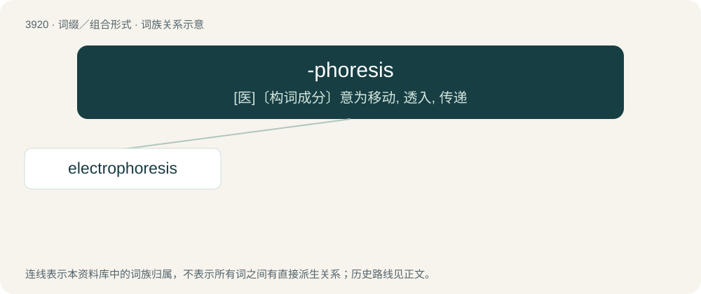

# 3948 · -phoresis — \[医\]〔构词成分〕意为移动, 透入, 传递

[总目录](../00_总目录_按常用程度.md)

**类型**：词缀／组合形式　｜　**来源语言**：见词源记录

## 核心含义与来源

- 核心含义：\[医\]〔构词成分〕意为移动, 透入, 传递
- 英文含义：transmission or movement of particles
- 词形：-phoresis

**来源记录 1**（后缀／后置成分；transmission or movement of particles）

Borrowed from Ancient Greek φόρησῐς (phórēsĭs, “an act of bearing, wearing”), from φορέω (phoréō, “to bear repeatedly or habitually; to be carried along”) + -σῐς (-sĭs, action noun suffix).

## 词族图

## 单词速览（常用到不常用）

| 单词 | 音标 | 释义 |
|---|---|---|
| [electrophoresis](#w-1) | /i,lektrəfəˈriːsis/ | n. 电泳；\[化\] 电泳 |

## 逐词详解

### 1. electrophoresis

**词性**：名词　｜　**音标**：/i,lektrəfəˈriːsis/

**中文释义**：n. 电泳；\[化\] 电泳

**英文义项**：The migration of electrically charged molecules through a medium under the influence of an electric field. / The separation and analysis of large molecules (such as proteins) by migrating a colloidal solution of them through a gel; gel electrophoresis.

**构词拆分**：electro- + -phoresis

**词源与演化**：

From electro- + -phoresis.

**例句**：

> Agarose gel electrophoresis is a method commonly used to separate DNA fragments based on their size.
