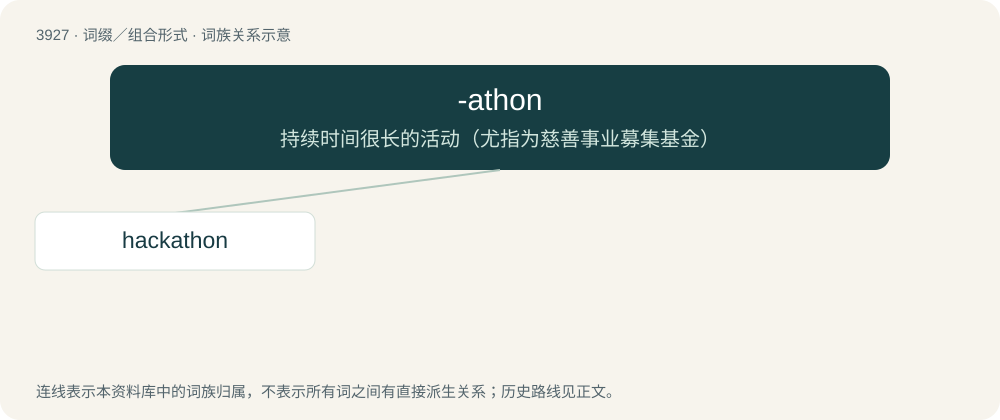

# 3954 · -athon — 持续时间很长的活动（尤指为慈善事业募集基金）

[总目录](../00_总目录_按常用程度.md)

**类型**：词缀／组合形式　｜　**来源语言**：见词源记录

## 核心含义与来源

- 核心含义：持续时间很长的活动（尤指为慈善事业募集基金）
- 英文含义：An event, usually collaborative, characterized by intense activity, effort, and time spent in connection to a specific theme or goal.
- 词形：-athon

**来源记录 1**（后缀／后置成分；An event, usually collaborative, characterized by intense activity, effort, and time spent in connection to a specific theme or goal.）

Rebracketing of marathon.

## 词族图

## 单词速览（常用到不常用）

| 单词 | 音标 | 释义 |
|---|---|---|
| [hackathon](#w-1) | 英 /ˈhæ.kə.θɒn/；美 /ˈhæ.kə.θɑn/ | \[网络\] 黑客马拉松；黑客松；骇客马拉松 |

## 逐词详解

### 1. hackathon

**词性**：名词　｜　**音标**：英 /ˈhæ.kə.θɒn/；美 /ˈhæ.kə.θɑn/

**中文释义**：\[网络\] 黑客马拉松；黑客松；骇客马拉松

**英文义项**：An event where programmers and others meet for collaborative software development, usually over several days.

**构词拆分**：hack + -athon

**词源与演化**：

From hack + -athon.

**例句**：

> What's taking place is the world's biggest hackathon!
