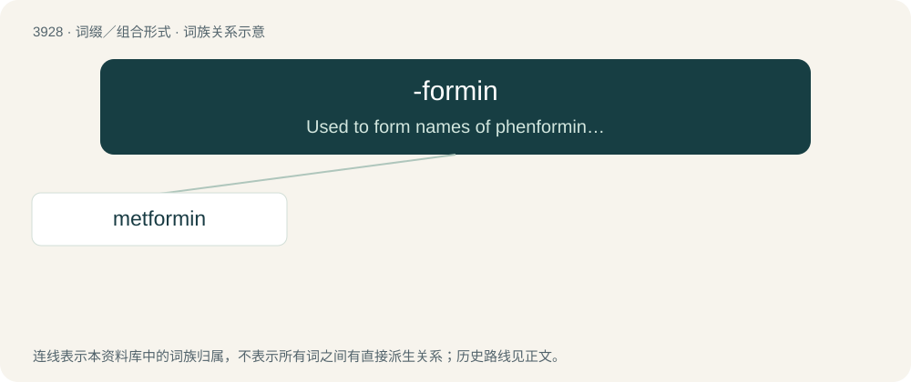

# 3955 · -formin — Used to form names of phenformin derivatives used as antihyperglycemics.

[总目录](../00_总目录_按常用程度.md)

**类型**：词缀／组合形式　｜　**来源语言**：见词源记录

## 核心含义与来源

- 核心含义：Used to form names of phenformin derivatives used as antihyperglycemics.
- 英文含义：Used to form names of phenformin derivatives used as antihyperglycemics.
- 词形：-formin

**来源记录 1**（后缀／后置成分；Used to form names of phenformin derivatives used as antihyperglycemics.）

From phenformin.

## 词族图

## 单词速览（常用到不常用）

| 单词 | 音标 | 释义 |
|---|---|---|
| [metformin](#w-1) | 英 /mɛtˈfɔː.mɪn/；美 /mɛtˈfɔɹ.mɪn/ | 甲福明二甲双胍(抗糖尿病药、降血糖药) |

## 逐词详解

### 1. metformin

**词性**：名词　｜　**音标**：英 /mɛtˈfɔː.mɪn/；美 /mɛtˈfɔɹ.mɪn/

**中文释义**：甲福明二甲双胍(抗糖尿病药、降血糖药)

**英文义项**：A biguanide derivative, C₄H₁₁N₅, used, now chiefly as the hydrochloride, as an oral hypoglycemic agent in the treatment of type 2 diabetes mellitus; 1,1-dimethylbiguanide.

**构词拆分**：From meth- + -formin (“phenformin derivative”).

**词源与演化**：

From meth- + -formin (“phenformin derivative”).
