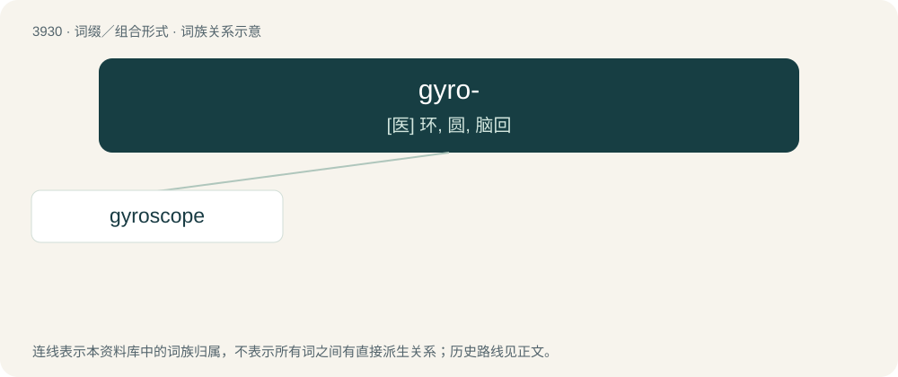

# 3956 · gyro- — \[医\] 环, 圆, 脑回

[总目录](../00_总目录_按常用程度.md)

**类型**：词缀／组合形式　｜　**来源语言**：见词源记录

## 核心含义与来源

- 核心含义：\[医\] 环, 圆, 脑回
- 英文含义：circle; circular or spinning motion
- 词形：gyro-

**来源记录 1**（前缀／前置成分；circle; circular or spinning motion）

From Ancient Greek γῦρος (gûros, “circle”). Also see gyre.

## 词族图

## 单词速览（常用到不常用）

| 单词 | 音标 | 释义 |
|---|---|---|
| [gyroscope](#w-1) | 英 /ˈd͡ʒaɪ.ɹəˌskəʊp/；美 /ˈd͡ʒaɪ.ɹəˌskoʊp/ | n. 陀螺仪, 回转仪；\[化\] 陀螺仪 |

## 逐词详解

### 1. gyroscope

**词性**：名词　｜　**音标**：英 /ˈd͡ʒaɪ.ɹəˌskəʊp/；美 /ˈd͡ʒaɪ.ɹəˌskoʊp/

**中文释义**：n. 陀螺仪, 回转仪；\[化\] 陀螺仪

**英文义项**：An apparatus composed of a wheel which spins inside of a frame (gimbal) and causes the balancing of the frame in any direction or position. In the form of a gyroscopic stabilizer, used to help keep aircraft and ships steady.

**构词拆分**：gyro- + -scope

**词源与演化**：

Borrowed from French gyroscope, coined in 1852 by physicist Leon Foucault, equivalent to gyro- + -scope, from Ancient Greek γῦρος (gûros, “circle”) and σκοπός (skopós, “watcher”).
