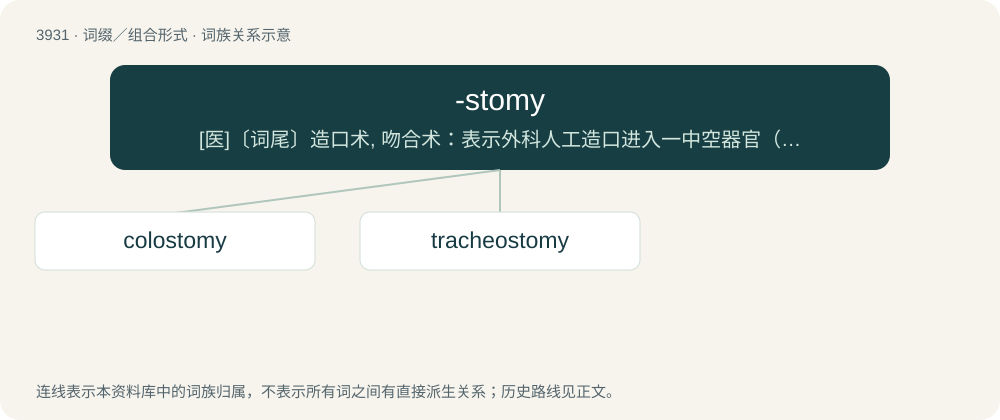

# 3957 · -stomy — \[医\]〔词尾〕造口术, 吻合术：表示外科人工造口进入一中空器官（如结肠造口术, 气管造口术）

[总目录](../00_总目录_按常用程度.md)

**类型**：词缀／组合形式　｜　**来源语言**：见词源记录

## 核心含义与来源

- 核心含义：\[医\]〔词尾〕造口术, 吻合术：表示外科人工造口进入一中空器官（如结肠造口术, 气管造口术）
- 英文含义：A surgical procedure forming a hole for access, nutrition, or waste elimination.
- 词形：-stomy

**来源记录 1**（后缀／后置成分；A surgical procedure forming a hole for access, nutrition, or waste elimination.）

Possibly from stoma + -y.

## 词族图

## 单词速览（常用到不常用）

| 单词 | 音标 | 释义 |
|---|---|---|
| [colostomy](#w-1) | /kəˈlɔstəmi/ | n. 结肠开口术；\[医\] 结肠造口术 |
| [tracheostomy](#w-2) | /.treikiˈɒtəmi/ | n. 气管切开术；\[医\] 气管造口术 |

## 逐词详解

### 1. colostomy

**词性**：名词　｜　**音标**：/kəˈlɔstəmi/

**中文释义**：n. 结肠开口术；\[医\] 结肠造口术

**英文义项**：An incision into the colon to allow for drainage. / The opening produced in such incision.

**构词拆分**：colo- + -stomy

**词源与演化**：

From colo- + -stomy.

### 2. tracheostomy

**词性**：名词　｜　**音标**：/.treikiˈɒtəmi/

**中文释义**：n. 气管切开术；\[医\] 气管造口术

**英文义项**：A surgical procedure in which an incision is made into the trachea, through the neck, and a tube inserted so as to make an artificial opening in order to assist breathing.

**构词拆分**：tracheo- + -stomy

**词源与演化**：

From tracheo- + -stomy.
