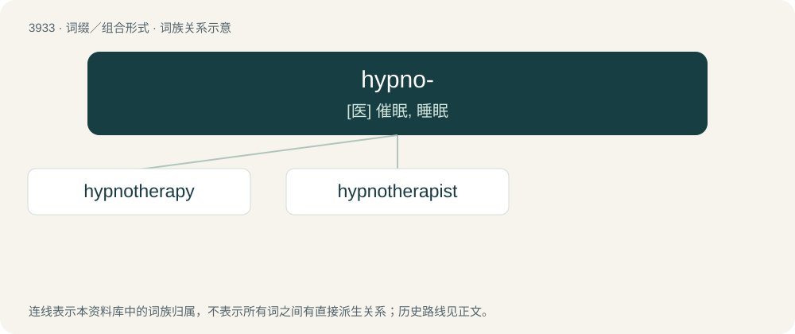

# 3958 · hypno- — \[医\] 催眠, 睡眠

[总目录](../00_总目录_按常用程度.md)

**类型**：词缀／组合形式　｜　**来源语言**：见词源记录

## 核心含义与来源

- 核心含义：\[医\] 催眠, 睡眠
- 英文含义：Related to sleep.
- 词形：hypno-

**来源记录 1**（前缀／前置成分；Related to sleep.）

From Ancient Greek ὕπνος (húpnos, “sleep”).

## 词族图

## 单词速览（常用到不常用）

| 单词 | 音标 | 释义 |
|---|---|---|
| [hypnotherapy](#w-1) | /ˌhɪpnoʊˈθɛɹəpi/ | n. 催眠疗法；\[医\] 催眠疗法 |
| [hypnotherapist](#w-2) | /hɪpnəʊˈθerəpɪst/ | \[医\]催眠治疗师 |

## 逐词详解

### 1. hypnotherapy

**词性**：名词　｜　**音标**：/ˌhɪpnoʊˈθɛɹəpi/

**中文释义**：n. 催眠疗法；\[医\] 催眠疗法

**英文义项**：Treatment of disease by means of hypnotism.

**构词拆分**：hypno- + therapy

**词源与演化**：

From hypno- + therapy.

**例句**：

> Tom underwent hypnotherapy to help him give up smoking.

### 2. hypnotherapist

**词性**：名词　｜　**音标**：/hɪpnəʊˈθerəpɪst/

**中文释义**：\[医\]催眠治疗师

**英文义项**：A practitioner of hypnotherapy.

**构词拆分**：From hypno- + therapist.

**词源与演化**：

From hypno- + therapist.

**例句**：

> Ivan had a session with a hypnotherapist.
