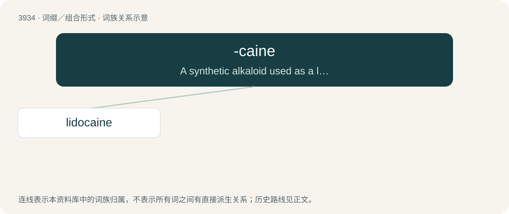

# 3959 · -caine — A synthetic alkaloid used as a local anesthetic.

[总目录](../00_总目录_按常用程度.md)

**类型**：词缀／组合形式　｜　**来源语言**：见词源记录

## 核心含义与来源

- 核心含义：A synthetic alkaloid used as a local anesthetic.
- 英文含义：A synthetic alkaloid used as a local anesthetic.
- 词形：-caine

**来源记录 1**（后缀／后置成分；A synthetic alkaloid used as a local anesthetic.）

From German -kain, extracted from the word Kokain (“cocaine”), because cocaine was formerly used as a local anaesthetic.

## 词族图

## 单词速览（常用到不常用）

| 单词 | 音标 | 释义 |
|---|---|---|
| [lidocaine](#w-1) | 英 /ˈlɪd.ə(ʊ).keɪn/；美 /ˈlaɪ.dəˌkeɪn/ | \[化\] 利多卡因；\[医\] 利多卡因, 塞罗卡因 |

## 逐词详解

### 1. lidocaine

**词性**：名词　｜　**音标**：英 /ˈlɪd.ə(ʊ).keɪn/；美 /ˈlaɪ.dəˌkeɪn/

**中文释义**：\[化\] 利多卡因；\[医\] 利多卡因, 塞罗卡因

**英文义项**：A crystalline compound, C₁₄H₂₂N₂O, that is used in the form of its hydrochloride as a local anesthetic and as an antiarrhythmic agent.

**构词拆分**：(acetani)lid(e) + -o- + -caine

**词源与演化**：

From (acetani)lid(e) + -o- + -caine, from cocaine.
