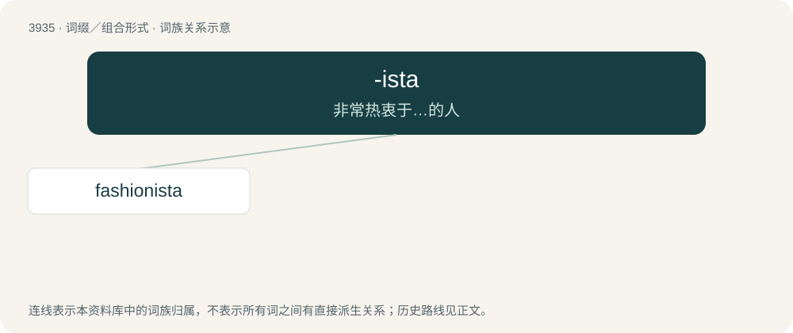

# 3960 · -ista — 非常热衷于…的人

[总目录](../00_总目录_按常用程度.md)

**类型**：词缀／组合形式　｜　**来源语言**：见词源记录

## 核心含义与来源

- 核心含义：非常热衷于…的人
- 英文含义：Forms nouns denoting one who follows a principle; an adept.
- 词形：-ista

**来源记录 1**（后缀／后置成分；Forms nouns denoting one who follows a principle; an adept.）

From Spanish -ista in Sandinista (1930s). Doublet of -ist.

## 词族图

## 单词速览（常用到不常用）

| 单词 | 音标 | 释义 |
|---|---|---|
| [fashionista](#w-1) | 英 /ˌfæ.ʃəˈnɪ.stə/；美 /ˌfæ.ʃəˈni.stə/ | n. 非常时髦的人 |

## 逐词详解

### 1. fashionista

**词性**：名词　｜　**音标**：英 /ˌfæ.ʃəˈnɪ.stə/；美 /ˌfæ.ʃəˈni.stə/

**中文释义**：n. 非常时髦的人

**英文义项**：A person who creates or promotes high fashion, i.e. a fashion designer or fashion editor. / A person who dresses according to the trends of fashion, or one who closely follows those trends.

**构词拆分**：fashion + -ista

**词源与演化**：

From fashion + -ista. Compare earlier Sandinista, Peronista, Guardianista. Piecewise doublet of earlier fashionist.

**例句**：

> The 72-year-old fashionista has provided clothing for over 1000 movies, theater productions and fashion shows in the past 45 years.
