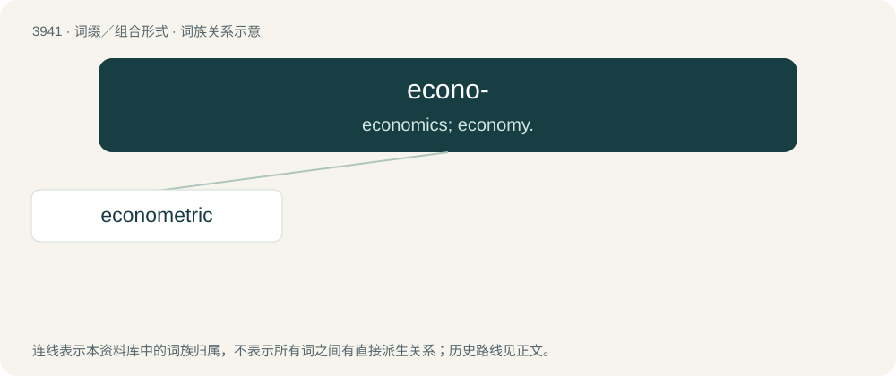

# 3965 · econo- — economics; economy.

[总目录](../00_总目录_按常用程度.md)

**类型**：词缀／组合形式　｜　**来源语言**：见词源记录

## 核心含义与来源

- 核心含义：economics; economy.
- 英文含义：economics; economy.
- 词形：econo-

## 词族图

## 单词速览（常用到不常用）

| 单词 | 音标 | 释义 |
|---|---|---|
| [econometric](#w-1) | /i,kɔnəˈmetrik/ | a. 计量经济学的 |

## 逐词详解

### 1. econometric

**词性**：形容词　｜　**音标**：/i,kɔnəˈmetrik/

**中文释义**：a. 计量经济学的

**英文义项**：Combining economics and mathematics; relating to measurement of an economy

**构词拆分**：econo- + -metric

**词源与演化**：

From econo- + -metric.
