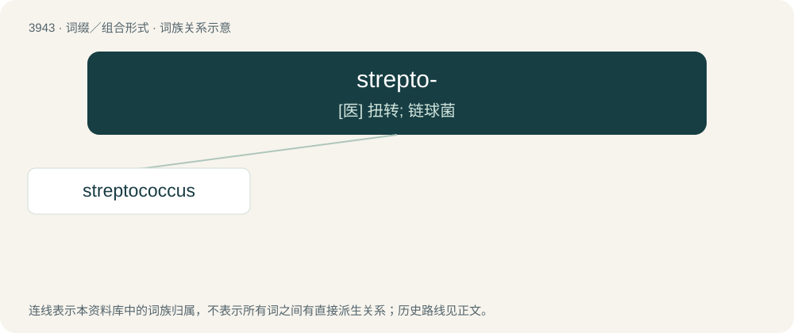

# 3967 · strepto- — \[医\] 扭转; 链球菌

[总目录](../00_总目录_按常用程度.md)

**类型**：词缀／组合形式　｜　**来源语言**：见词源记录

## 核心含义与来源

- 核心含义：\[医\] 扭转; 链球菌
- 英文含义：twisted
- 词形：strepto-

**来源记录 1**（前缀／前置成分；twisted）

From Ancient Greek στρεπτός (streptós, “twisted”) from στρέφειν (stréphein, “to twist”), from Proto-Indo-European \*streb(h)- (“to wind, turn, twist”).

## 词族图

## 单词速览（常用到不常用）

| 单词 | 音标 | 释义 |
|---|---|---|
| [streptococcus](#w-1) | 英 /ˌstɹɛptəˈkɒkəs/；美 /ˌstɹɛptəˈkɑkəs/ | n. 链球菌；\[医\] 链球菌属 |

## 逐词详解

### 1. streptococcus

**词性**：名词　｜　**音标**：英 /ˌstɹɛptəˈkɒkəs/；美 /ˌstɹɛptəˈkɑkəs/

**中文释义**：n. 链球菌；\[医\] 链球菌属

**英文义项**：A spherical, gram-positive bacterium of the genus Streptococcus. Although commonly found benignly in the human mouth and gut, and though many species are non-pathogenic, other species can cause diseases including strep throat and more serious conditions.

**构词拆分**：strepto- + -coccus

**词源与演化**：

Morphologically a compound of strepto- + -coccus. They grow in chains or pairs, thus the name — from Ancient Greek στρεπτός (streptós, “twisted, pliant”), like a chain. Compare the genus name Streptococcus.

**例句**：

> What are the risks of group B streptococcus (GBS) infection during pregnancy?
