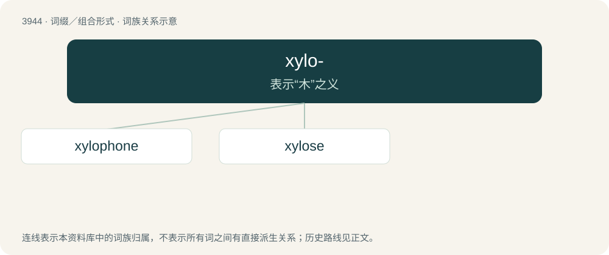

# 3968 · xylo- — 表示“木”之义

[总目录](../00_总目录_按常用程度.md)

**类型**：词缀／组合形式　｜　**来源语言**：见词源记录

## 核心含义与来源

- 核心含义：表示“木”之义
- 英文含义：wood
- 词形：xylo-

**来源记录 1**（前缀／前置成分；wood）

From Ancient Greek ξῠ́λον (xŭ́lon, “wood”).

## 词族图

## 单词速览（常用到不常用）

| 单词 | 音标 | 释义 |
|---|---|---|
| [xylophone](#w-1) | 英 /ˈzaɪ.ləˌfəʊn/；美 /ˈzaɪləˌfoʊn/ | n. 木琴 |
| [xylose](#w-2) | /ˈzailəus/ | n. 木糖；\[化\] 木糖 |

## 逐词详解

### 1. xylophone

**词性**：名词　｜　**音标**：英 /ˈzaɪ.ləˌfəʊn/；美 /ˈzaɪləˌfoʊn/

**中文释义**：n. 木琴

**英文义项**：Any musical instrument (percussion idiophone) made of wooden slats graduated so as to make the sounds of the scale when struck with a small drumstick-like mallet; the standard Western concert xylophone or one of its derivatives.

**构词拆分**：xylo- (“of wood”) + -phone (“sound”)

**词源与演化**：

From xylo- (“of wood”) + -phone (“sound”).

**例句**：

> All I know how to play on my xylophone is "Mary Had a Little Lamb". Would you like to hear it?

该用例对应义项：Any musical instrument (percussion idiophone) made of wooden slats graduated so as to make the sounds of the scale when struck with a small drumstick-like mallet; the standard Western concert xylophone or one of its derivatives.

### 2. xylose

**词性**：名词　｜　**音标**：/ˈzailəus/

**中文释义**：n. 木糖；\[化\] 木糖

**英文义项**：One of the pentoses, C₅H₁₀O₅, a white crystalline sugar, derived from wood.

**构词拆分**：xylo- + -ose

**词源与演化**：

From xylo- + -ose.
