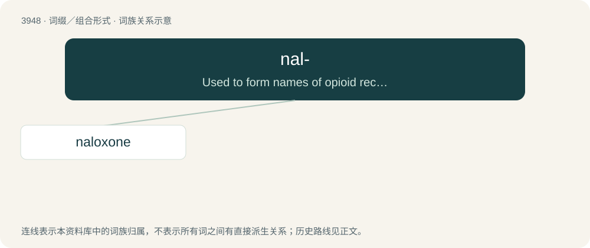

# 3971 · nal- — Used to form names of opioid receptor antagonists or agonists related to normorphine.

[总目录](../00_总目录_按常用程度.md)

**类型**：词缀／组合形式　｜　**来源语言**：见词源记录

## 核心含义与来源

- 核心含义：Used to form names of opioid receptor antagonists or agonists related to normorphine.
- 英文含义：Used to form names of opioid receptor antagonists or agonists related to normorphine.
- 词形：nal-

**来源记录 1**（前缀／前置成分；Used to form names of opioid receptor antagonists or agonists related to normorphine.）

From nalorphine.

## 词族图

## 单词速览（常用到不常用）

| 单词 | 音标 | 释义 |
|---|---|---|
| [naloxone](#w-1) | 英 /nəˈlɒk.səʊn/；美 /nəˈlɑkˌsoʊn/ | \[化\] 纳洛酮 |

## 逐词详解

### 1. naloxone

**词性**：名词　｜　**音标**：英 /nəˈlɒk.səʊn/；美 /nəˈlɑkˌsoʊn/

**中文释义**：\[化\] 纳洛酮

**英文义项**：An opioid inverse agonist used to counter the effects of an overdose on opioids (such as heroin or morphine).

**构词拆分**：nal- + hydroxy + -one

**词源与演化**：

From nal- (“opioid receptor antagonist/agonist”) + (hydr)ox(y) + -one.

**例句**：

> Naloxone is a life-saving drug that can reverse the effects of an opioid overdose.
