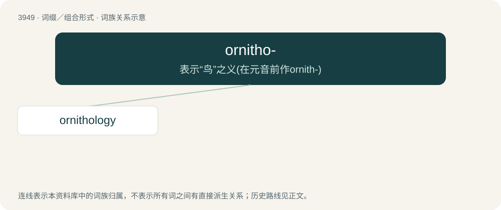

# 3972 · ornitho- — 表示“鸟”之义(在元音前作ornith-)

[总目录](../00_总目录_按常用程度.md)

**类型**：词缀／组合形式　｜　**来源语言**：见词源记录

## 核心含义与来源

- 核心含义：表示“鸟”之义(在元音前作ornith-)
- 英文含义：of or pertaining to birds
- 词形：ornitho-

**来源记录 1**（前缀／前置成分；of or pertaining to birds）

From Ancient Greek ὄρνιθ- (órnith-), the stem of ὄρνις (órnis, “bird”).

## 词族图

## 单词速览（常用到不常用）

| 单词 | 音标 | 释义 |
|---|---|---|
| [ornithology](#w-1) | 英 /ˌɔːnɪˈθɒlədʒi/；美 /ˌɔɹnɪˈθɑlədʒi/ | n. 鸟类学 |

## 逐词详解

### 1. ornithology

**词性**：名词　｜　**音标**：英 /ˌɔːnɪˈθɒlədʒi/；美 /ˌɔɹnɪˈθɑlədʒi/

**中文释义**：n. 鸟类学

**英文义项**：The branch of zoology that deals with the scientific study of birds.

**构词拆分**：ornitho- + -logy

**词源与演化**：

From New Latin ornithologia, coined by Ulisse Aldrovandi from Ancient Greek ὀρνιθολόγος (ornithológos), from ὄρνις (órnis) and λόγος (lógos). See also ornitho- + -logy.

**例句**：

> Today he works at the Lab of Ornithology, unraveling avian mysteries.
