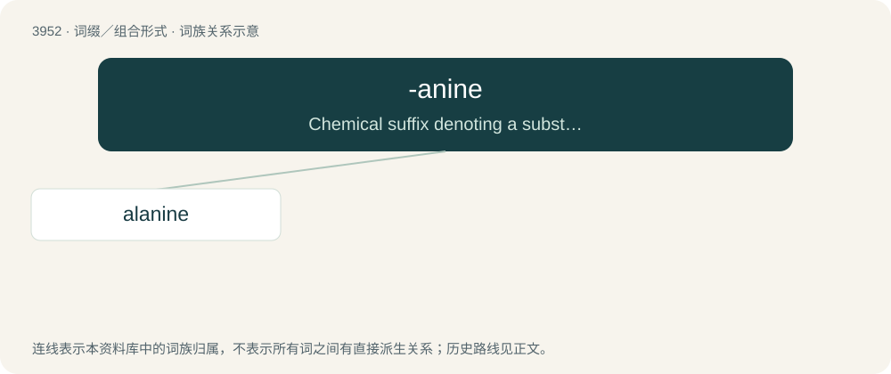

# 3976 · -anine — Chemical suffix denoting a substance (usually an alkaloid or amine) derived from a particular base, often a plant or amino acid.

[总目录](../00_总目录_按常用程度.md)

**类型**：词缀／组合形式　｜　**来源语言**：见词源记录

## 核心含义与来源

- 核心含义：Chemical suffix denoting a substance (usually an alkaloid or amine) derived from a particular base, often a plant or amino acid.
- 英文含义：Chemical suffix denoting a substance (usually an alkaloid or amine) derived from a particular base, often a plant or amino acid.
- 词形：-anine

**来源记录 1**（后缀／后置成分；Chemical suffix denoting a substance (usually an alkaloid or amine) derived from a particular base, often a plant or amino acid.）

From -ane + -ine.

## 词族图

## 单词速览（常用到不常用）

| 单词 | 音标 | 释义 |
|---|---|---|
| [alanine](#w-1) | /ˈæləniːn/ | n. 丙氨酸；\[医\] 丙氨酸 |

## 逐词详解

### 1. alanine

**词性**：名词　｜　**音标**：/ˈæləniːn/

**中文释义**：n. 丙氨酸；\[医\] 丙氨酸

**英文义项**：A nonessential amino acid 2-aminopropanoic acid found in most animal proteins / A specific residue, molecule, or isomer of this amino acid

**构词拆分**：aldehyde + -anine

**词源与演化**：

From aldehyde + -anine, in reference to aldehyde, with the infix -an- for ease of pronunciation, when the German chemist Adolph Strecker first synthesized alanine in 1850 by mixing acetaldehyde (then just known as aldehyde) with ammonia, hydrogen cyanide, and hydrochloric acid.

**例句**：

> Potatoes can be a good source of alanine.

该用例对应义项：A nonessential amino acid 2-aminopropanoic acid found in most animal proteins
