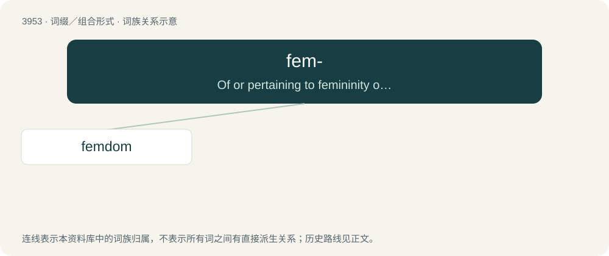

# 3977 · fem- — Of or pertaining to femininity or women.

[总目录](../00_总目录_按常用程度.md)

**类型**：词缀／组合形式　｜　**来源语言**：见词源记录

## 核心含义与来源

- 核心含义：Of or pertaining to femininity or women.
- 英文含义：Of or pertaining to femininity or women.
- 词形：fem-

**来源记录 1**（前缀／前置成分；Of or pertaining to femininity or women.）

Clipping of female or feminine.

## 词族图

## 单词速览（常用到不常用）

| 单词 | 音标 | 释义 |
|---|---|---|
| [femdom](#w-1) | 英 /ˈfɛmˌdɒm/；美 /ˈfɛmˌdɑm/ | 【英文】Female domination; a sexual practice in which women dominate men or other people. |

## 逐词详解

### 1. femdom

**词性**：名词　｜　**音标**：英 /ˈfɛmˌdɒm/；美 /ˈfɛmˌdɑm/

**英文义项**：Female domination; a sexual practice in which women dominate men or other people. / A female dominator in sadomasochistic sexual practices.

**构词拆分**：fem- + -dom

**词源与演化**：

From fem- + -dom (“domination”).

**例句**：

> Femdom is short for Female Domination.
