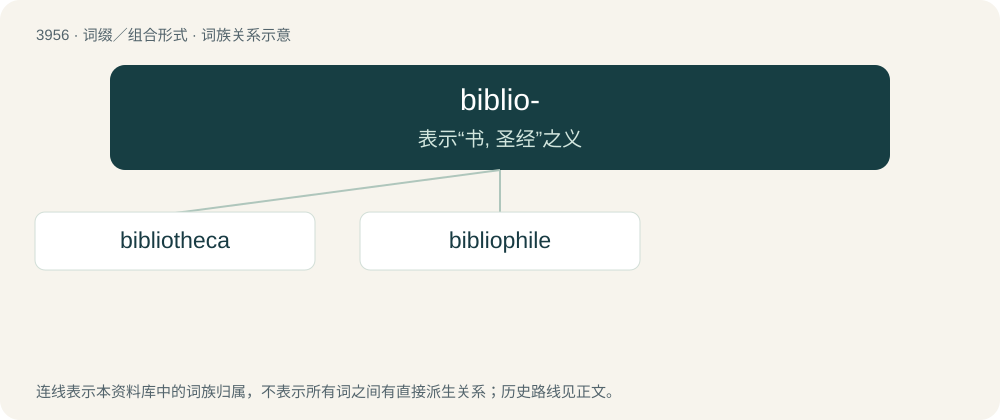

# 3979 · biblio- — 表示“书, 圣经”之义

[总目录](../00_总目录_按常用程度.md)

**类型**：词缀／组合形式　｜　**来源语言**：见词源记录

## 核心含义与来源

- 核心含义：表示“书, 圣经”之义
- 英文含义：book
- 词形：biblio-

**来源记录 1**（前缀／前置成分；book）

From Ancient Greek βιβλίον (biblíon, “paper, document, tablet, small book”) or its descendant Latin Biblia (“the Bible”).

## 词族图

## 单词速览（常用到不常用）

| 单词 | 音标 | 释义 |
|---|---|---|
| [bibliotheca](#w-1) | /ˌbɪbli.əˈθiːkə/ | n. 藏书, 图书馆, 书目 |
| [bibliophile](#w-2) | 英 /ˈbɪblɪəˌfaɪl/；美 /ˈbɪb li əˌfaɪl/ | n. 爱书者, 藏书家 |

## 逐词详解

### 1. bibliotheca

**词性**：名词　｜　**音标**：/ˌbɪbli.əˈθiːkə/

**中文释义**：n. 藏书, 图书馆, 书目

**英文义项**：A library.

**构词拆分**：biblio- + -theca

**词源与演化**：

Learned borrowing from Latin bibliothēca, borrowed from Ancient Greek βιβλιοθήκη (bibliothḗkē, “library”). Equivalent to biblio- + -theca. Doublet of bibliotheque.

### 2. bibliophile

**词性**：名词　｜　**音标**：英 /ˈbɪblɪəˌfaɪl/；美 /ˈbɪb li əˌfaɪl/

**中文释义**：n. 爱书者, 藏书家

**英文义项**：One who loves books. / One who collects books, not necessarily due to any interest in reading them.

**构词拆分**：biblio- + -phile

**词源与演化**：

First attested in 1820. From biblio- + -phile (from Ancient Greek βιβλίον (biblíon, “paper, document, tablet”) + φίλος (phílos, “beloved”)), probably after French bibliophile.
