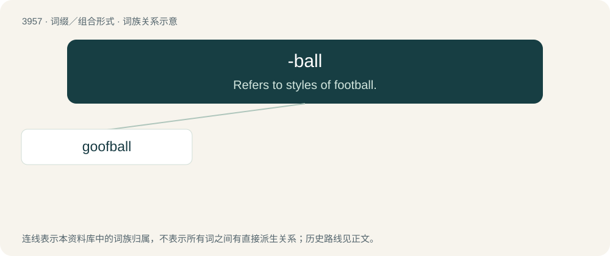

# 3982 · -ball — Refers to styles of football.

[总目录](../00_总目录_按常用程度.md)

**类型**：词缀／组合形式　｜　**来源语言**：见词源记录

## 核心含义与来源

- 核心含义：Refers to styles of football.
- 英文含义：Refers to styles of football.
- 词形：-ball

**多个词源／构词路径**：同一拼写可能有不同来源；以下按词性和含义分别列出。

**来源记录 1**（后缀／后置成分；Refers to styles of football.）

Back-formation from football. Journalist Jamie Braidwood suggests it may have been inspired by Michael Lewis' 2003 book Moneyball and its 2011 film adaptation.

**来源记录 2**（后缀／后置成分；forms nouns with the meaning "one who is characterized by".）

Likely from figurative use of ball.

## 词族图

## 单词速览（常用到不常用）

| 单词 | 音标 | 释义 |
|---|---|---|
| [goofball](#w-1) | 美 /ˈɡufˌbɔl/ | n. 催眠药片, 兴奋剂, 镇静剂, 神经失常的人, 怪人 |

## 逐词详解

### 1. goofball

**词性**：名词　｜　**音标**：美 /ˈɡufˌbɔl/

**中文释义**：n. 催眠药片, 兴奋剂, 镇静剂, 神经失常的人, 怪人

**英文义项**：A foolish or silly person or animal. / A pill or tablet containing a pharmaceutical which has hypnotic or intoxicating effects, especially a barbiturate.

**构词拆分**：goof + -ball

**词源与演化**：

From goof + -ball.

**例句**：

> If that goofball would put half the effort into her studies as she does into her juggling, she might do very well.

该用例对应义项：A foolish or silly person or animal.
