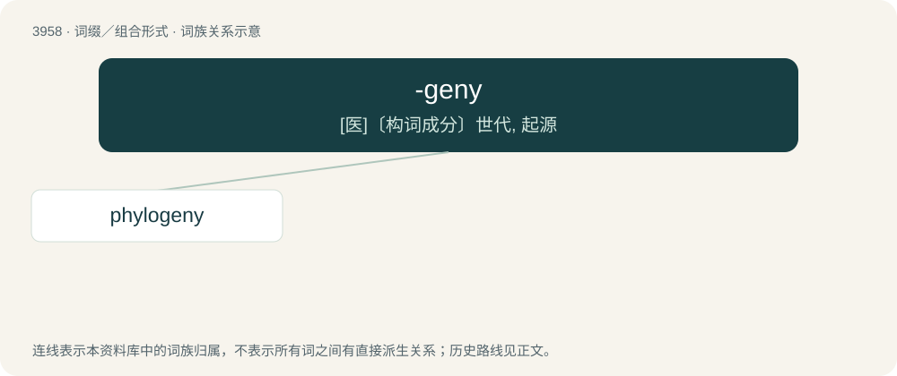

# 3983 · -geny — \[医\]〔构词成分〕世代, 起源

[总目录](../00_总目录_按常用程度.md)

**类型**：词缀／组合形式　｜　**来源语言**：见词源记录

## 核心含义与来源

- 核心含义：\[医\]〔构词成分〕世代, 起源
- 英文含义：production
- 词形：-geny

**来源记录 1**（后缀／后置成分；production）

Borrowed from Ancient Greek -γένεια (-géneia).

## 词族图

## 单词速览（常用到不常用）

| 单词 | 音标 | 释义 |
|---|---|---|
| [phylogeny](#w-1) | 英 /faɪˈlɒd͡ʒəni/；美 /faɪˈlɑd͡ʒəni/ | n. 种系发生, 发展史, 语系发生；\[医\] 种系发生, 种族发育 |

## 逐词详解

### 1. phylogeny

**词性**：名词　｜　**音标**：英 /faɪˈlɒd͡ʒəni/；美 /faɪˈlɑd͡ʒəni/

**中文释义**：n. 种系发生, 发展史, 语系发生；\[医\] 种系发生, 种族发育

**英文义项**：The evolutionary history of groups of organisms, such as species or clades. / A phylogenetic diagram.

**构词拆分**：phylo- + -geny

**词源与演化**：

Borrowed from German Phylogenie, coined by Ernst Haeckel in 1866, a neologism created as if borrowed from a Classic Greek word φυλογένεια (phulogéneia), composed from Ancient Greek φῦλον (phûlon, “tribe, genus, species”) + -γένεια (-géneia, “-geny (generation, production)”), equivalent to phylo- + -geny.

**例句**：

> Understanding the phylogeny of this musical group helps us understand its music.

该用例对应义项：The historical development of a human social or racial group.
