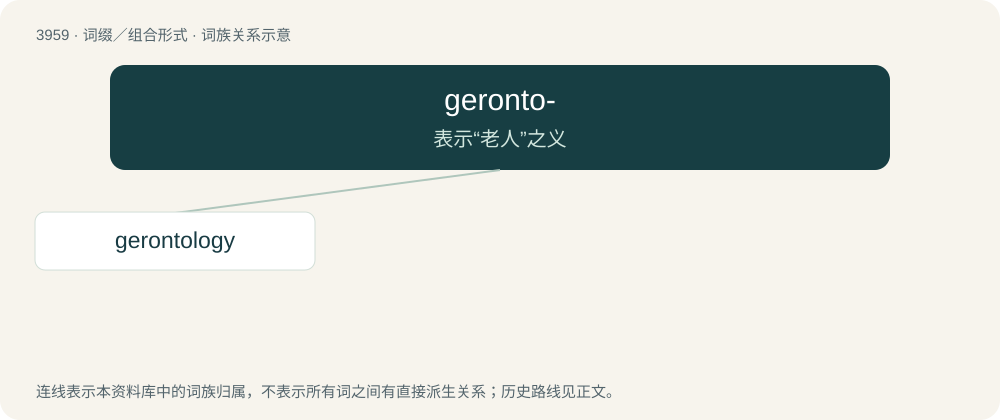

# 3984 · geronto- — 表示“老人”之义

[总目录](../00_总目录_按常用程度.md)

**类型**：词缀／组合形式　｜　**来源语言**：见词源记录

## 核心含义与来源

- 核心含义：表示“老人”之义
- 英文含义：Forms terms relating to old age or elderly people.
- 词形：geronto-

**来源记录 1**（前缀／前置成分；Forms terms relating to old age or elderly people.）

Derived from Ancient Greek γέροντος (gérontos, “old man”).

## 词族图

## 单词速览（常用到不常用）

| 单词 | 音标 | 释义 |
|---|---|---|
| [gerontology](#w-1) | /.dʒerɒnˈtɒlədʒi/ | n. 老年医学, 老人学；\[医\] 老年医学, 老年病学, 老人学 |

## 逐词详解

### 1. gerontology

**词性**：名词　｜　**音标**：/.dʒerɒnˈtɒlədʒi/

**中文释义**：n. 老年医学, 老人学；\[医\] 老年医学, 老年病学, 老人学

**英文义项**：The study of the elderly, and of the aging process itself. / The branch of science that deals with the problems of aged people. It is to be distinguished from geriatrics, which is the study of the diseases of the elderly. Gerontology covers the social, psychological and biological aspects of aging.

**构词拆分**：geronto- + -logy

**词源与演化**：

From geronto- + -logy.

**例句**：

> Sandra began her community service after earning a graduate degree in gerontology.
