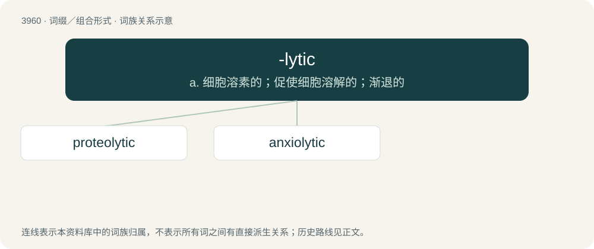

# 3985 · -lytic — a. 细胞溶素的；促使细胞溶解的；渐退的

[总目录](../00_总目录_按常用程度.md)

**类型**：词缀／组合形式　｜　**来源语言**：见词源记录

## 核心含义与来源

- 核心含义：a. 细胞溶素的；促使细胞溶解的；渐退的
- 英文含义：Used in adjectives relating to nouns with the suffix -lysis.
- 词形：-lytic

**来源记录 1**（后缀／后置成分；Used in adjectives relating to nouns with the suffix -lysis.）

From -lysis + -tic.

## 词族图

## 单词速览（常用到不常用）

| 单词 | 音标 | 释义 |
|---|---|---|
| [proteolytic](#w-1) | /prəutiəˈlitik/ | a. 解朊的, 水解蛋白质的, 蛋白水解作用的；\[化\] 解蛋白的; 分解蛋白的 |
| [anxiolytic](#w-2) | 英 /ˌæŋksiəˈlɪtɪk/；美 /ˌeɪŋziəˈlɪtɪk/ | n. 抗焦虑药 |

## 逐词详解

### 1. proteolytic

**词性**：形容词　｜　**音标**：/prəutiəˈlitik/

**中文释义**：a. 解朊的, 水解蛋白质的, 蛋白水解作用的；\[化\] 解蛋白的; 分解蛋白的

**英文义项**：Of, relating to, or promoting proteolysis.

**构词拆分**：From proteo- + -lytic.

**词源与演化**：

From proteo- + -lytic.

### 2. anxiolytic

**词性**：形容词　｜　**音标**：英 /ˌæŋksiəˈlɪtɪk/；美 /ˌeɪŋziəˈlɪtɪk/

**中文释义**：n. 抗焦虑药

**英文义项**：That reduces anxiety; tranquilizing.

**构词拆分**：anxio- + -lytic

**词源与演化**：

From anxio- + -lytic.
