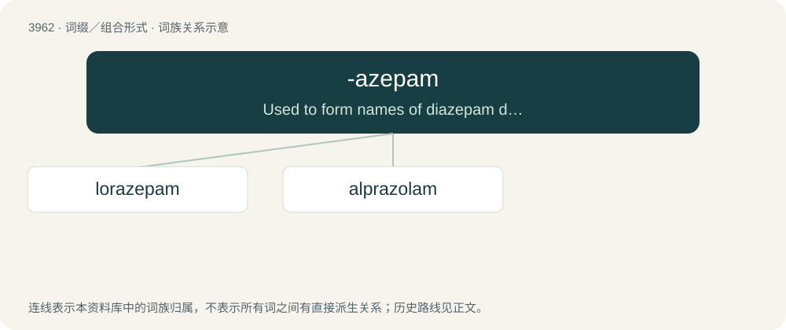

# 3987 · -azepam — Used to form names of diazepam derivatives.

[总目录](../00_总目录_按常用程度.md)

**类型**：词缀／组合形式　｜　**来源语言**：见词源记录

## 核心含义与来源

- 核心含义：Used to form names of diazepam derivatives.
- 英文含义：Used to form names of diazepam derivatives.
- 词形：-azepam

**来源记录 1**（后缀／后置成分；Used to form names of diazepam derivatives.）

From diazepam.

## 词族图

## 单词速览（常用到不常用）

| 单词 | 音标 | 释义 |
|---|---|---|
| [lorazepam](#w-1) | 英 /lɔːˈɹeɪ.zɪ.pam/；美 /lɔɹˈæz.əˌpæm/ | \[化\] 劳拉西泮; 氯羟去甲安定 |
| [alprazolam](#w-2) | 英 /alˈpɹeɪ.zəʊ.lam/；美 /ælˈpɹæz.əˌlæm/ | \[化\] 阿普唑仑 |

## 逐词详解

### 1. lorazepam

**词性**：名词　｜　**音标**：英 /lɔːˈɹeɪ.zɪ.pam/；美 /lɔɹˈæz.əˌpæm/

**中文释义**：\[化\] 劳拉西泮; 氯羟去甲安定

**英文义项**：A drug of the benzodiazepine group, used especially to treat anxiety.

**构词拆分**：chlor- + -azepam；(ch)lor- + -azepam (“diazepam derivative”)

**词源与演化**：

From (ch)lor- + -azepam (“diazepam derivative”).

**例句**：

> I was involuntarily shot up with lorazepam and chlorpromazine.

### 2. alprazolam

**词性**：名词　｜　**音标**：英 /alˈpɹeɪ.zəʊ.lam/；美 /ælˈpɹæz.əˌlæm/

**中文释义**：\[化\] 阿普唑仑

**英文义项**：A drug (trademark Xanax) of the benzodiazepine group (8-chloro-1-methyl-6-phenyl-4H-\[1,2,4\]triazolo\[4,3-a\]\[1,4\]benzodiazepine), used in the treatment of anxiety.

**构词拆分**：alpha + phenyl + triazolo + -azepam

**词源与演化**：

From al(pha) + p(henyl) + (t)r(i)azol(o) + -(azep)am.
