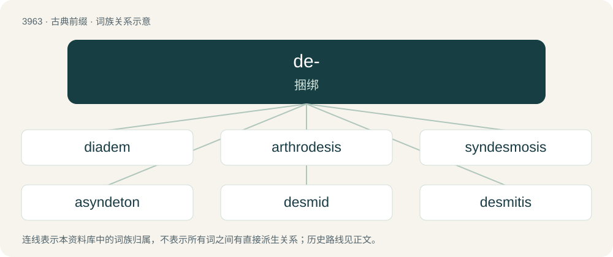

# 3989 · de- — 捆绑

[总目录](../00_总目录_按常用程度.md)

**类型**：古典前缀　｜　**来源语言**：古希腊语

## 核心含义与来源

- 核心含义：捆绑
- 英文含义：bind
- 词形：de-

**来源词形**：δεῖν (deîn), δετός, δέσις (detós, désis), δέμα (déma), δεσμός (desmós), δέσμα (désma)

## 词族图

## 单词速览（常用到不常用）

| 单词 | 音标 | 释义 |
|---|---|---|
| [diadem](#w-1) | /ˈdaɪ.əˌdɛm/ | n. 王冠, 王冠状物, 王权 |
| [arthrodesis](#w-2) | /aɹθˈɹɒdɪsɪs/ | n. \[医\]关节固定术,人为关节强硬术 |
| [syndesmosis](#w-3) | 英 /ˌsɪn.dɛzˈməʊ.sɪs/；美 /ˌsɪn.dɛzˈmoʊ.sɪs/ | n. \[解\]韧带联合 |
| [asyndeton](#w-4) | /əˈsɪndətən/ | n. 连接词省略 |
| [desmid](#w-5) | 英 /ˈdɛz.mɪd/ | n. \[植\]带藻 |
| [desmitis](#w-6) | /desˈmaitis/ | n. \[医\]韧带炎 |
| [desmoid](#w-7) | /ˈdesmɔid/ | n. \[医\]硬纤维瘤；a. 硬纤维的 |
| [desmoplasia](#w-8) |  | \[医\] 结缔织生成 |
| [desmosome](#w-9) | /ˈdesməsəm/ | n. \[生化\]细胞桥粒(上皮细胞膜中的局部增厚部份) |
| [plasmodesma](#w-10) | /,plæzməjˈdezmə/ | n. \[植\]胞间连丝 |
| [polysyndeton](#w-11) | /pɒlɪˈsɪndɪtɒn/ | n. \[语\]连词叠用 |
| [syndesis](#w-12) | /sɪnˈdiːsɪs/ | 捆扎, 联结 |
| [syndetic](#w-13) | /sɪnˈdɛtɪk/ | a. 连结的；\[计\] 连接的 |
| [syndeton](#w-14) | 英 /ˈsɪndɪtɒn/；美 /ˈsɪndətɑn/ | n. \[语\]连接结构 |

## 逐词详解

### 1. diadem

**词性**：名词　｜　**音标**：/ˈdaɪ.əˌdɛm/

**中文释义**：n. 王冠, 王冠状物, 王权

**英文义项**：An ornamental headband worn as a badge of royalty. / A crown.

**词源与演化**：

From Middle English diademe, dyademe, from Old French diademe, from Latin diadēma, from Ancient Greek διάδημα (diádēma, “band, especially worn around a tiara”), from διαδέω (diadéō, “bind around”).

### 2. arthrodesis

**词性**：名词　｜　**音标**：/aɹθˈɹɒdɪsɪs/

**中文释义**：n. \[医\]关节固定术,人为关节强硬术

**英文义项**：The surgical fusion of a joint between two or more bones so that the joint can no longer move; artificial ankylosis.

**构词拆分**：arthro- + -desis

**词源与演化**：

From arthro- + -desis.

### 3. syndesmosis

**词性**：名词　｜　**音标**：英 /ˌsɪn.dɛzˈməʊ.sɪs/；美 /ˌsɪn.dɛzˈmoʊ.sɪs/

**中文释义**：n. \[解\]韧带联合

**英文义项**：A slightly movable articulation or joint where the contiguous bony surfaces are rough and are united by an interosseous ligament (e.g. between the fibula and tibia at the ankle).

**词源与演化**：

Borrowed from New Latin syndesmōsis.

### 4. asyndeton

**词性**：名词　｜　**音标**：/əˈsɪndətən/

**中文释义**：n. 连接词省略

**英文义项**：Omission of conjunctions, especially for rhetorical effect.

**构词拆分**：a- + syndeton

**词源与演化**：

From Latin asyndeton, from Ancient Greek ἀσύνδετον (asúndeton), from ἀ- (a-, “a-, un-, non-”) and the neuter substantive of σῠ́νδετος (sŭ́ndetos, “bound, joined”), from συνδεῖν (sundeîn, “to join, to bind”), from σῠν- (sŭn-, “together”) + δεῖν (deîn, “to bind, to tie”). Equivalent to a- + syndeton.

### 5. desmid

**词性**：名词　｜　**音标**：英 /ˈdɛz.mɪd/

**中文释义**：n. \[植\]带藻

**英文义项**：Any of about 5000 species of mostly unicellular freshwater green algae belonging to the order Desmidiales.

**词源与演化**：

From Ancient Greek δεσμός (desmós, “ligature, ligament, bond”).

### 6. desmitis

**词性**：名词　｜　**音标**：/desˈmaitis/

**中文释义**：n. \[医\]韧带炎

**英文义项**：inflammation of a ligament.

**词源与演化**：

Ancient Greek δεσμός (desmós, “band, connection”) + -itis

### 7. desmoid

**词性**：形容词　｜　**音标**：/ˈdesmɔid/

**中文释义**：n. \[医\]硬纤维瘤；a. 硬纤维的

**英文义项**：Pertaining to a bundle. / Fibrous; having closely interwoven fibres in bundles.

**词源与演化**：

From Ancient Greek δεσμός (desmós, “chain, bundle”) + -oid.

### 8. desmoplasia

**词性**：名词

**中文释义**：\[医\] 结缔织生成

**英文义项**：A desmoplastic hyperplasia of fibroblasts, found especially in the stroma of a carcinoma

### 9. desmosome

**词性**：名词　｜　**音标**：/ˈdesməsəm/

**中文释义**：n. \[生化\]细胞桥粒(上皮细胞膜中的局部增厚部份)

**英文义项**：A structural unit that functions in the adhesion of cells to form tissue.

**构词拆分**：desmo- + -some

**词源与演化**：

From desmo- + -some.

### 10. plasmodesma

**词性**：名词　｜　**音标**：/,plæzməjˈdezmə/

**中文释义**：n. \[植\]胞间连丝

**英文义项**：A microscopic channel traversing the cell walls of plant cells and some algal cells, enabling transport and communication between them.

**词源与演化**：

From Ancient Greek πλάσμα (plásma, “something formed”) + δέσμα (désma).

### 11. polysyndeton

**词性**：名词　｜　**音标**：/pɒlɪˈsɪndɪtɒn/

**中文释义**：n. \[语\]连词叠用

**英文义项**：The use of many conjunctions to achieve an overwhelming effect in a sentence.

**词源与演化**：

Borrowed from Medieval Latin polysyndeton, itself from Byzantine Greek πολυσύνδετον (polusúndeton, literally “many connected”).

### 12. syndesis

**词性**：名词　｜　**音标**：/sɪnˈdiːsɪs/

**中文释义**：捆扎, 联结

**英文义项**：Synonym of arthrodesis, the artificial fusion of a joint between two or more bones. / Synonym of syndeton, the use of conjunctions or syndetic constructions.

**构词拆分**：syn- + -desis

**词源与演化**：

Initially in cytology from German Syndesis, coined by Valentin Häcker in 1904 from Ancient Greek σύνδεσις (súndesis, “binding, joining”), from συνδεῖν (sundeîn, “to join, to bind”) + -σῐς (-sĭs, “-sis: forming nouns”), from σῠν- (sŭn-, “together”) + δεῖν (deîn, “to bind, to tie”). Equivalent to syn- + -desis.

### 13. syndetic

**词性**：形容词　｜　**音标**：/sɪnˈdɛtɪk/

**中文释义**：a. 连结的；\[计\] 连接的

**英文义项**：Of or related to syndeton, the use of a conjunction. / Synonym of connective, serving to connect.

**词源与演化**：

From Latin syndeticus, from Ancient Greek συνδετικός (sundetikós), from σύνδεσις (súndesis, “binding”) + -κός (-kós, “-ic: forming adjectives”), from συνδεῖν (sundeîn, “to join, to bind”), from σῠν- (sŭn-, “together”) + δεῖν (deîn, “to bind, to tie”).

**例句**：

> The dictionary includes syndetic references.

该用例对应义项：Synonym of crossreferenced.

### 14. syndeton

**词性**：名词　｜　**音标**：英 /ˈsɪndɪtɒn/；美 /ˈsɪndətɑn/

**中文释义**：n. \[语\]连接结构

**英文义项**：The use of conjunctions or conjunctive structures to connect words, phrases, etc.
