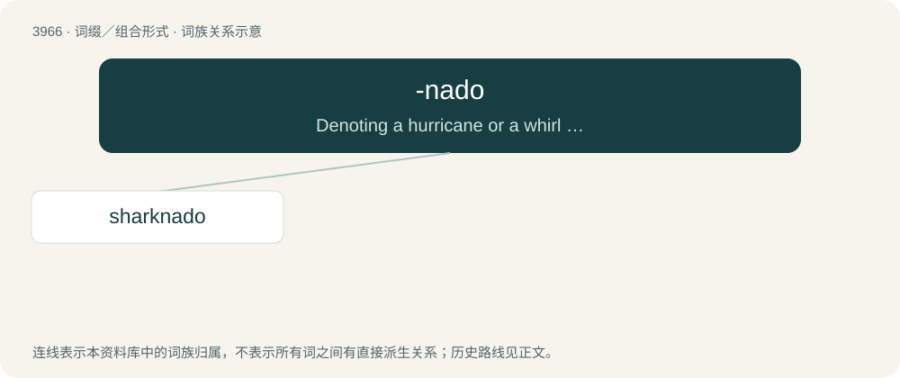

# 3992 · -nado — Denoting a hurricane or a whirl containing or made of the stem word.

[总目录](../00_总目录_按常用程度.md)

**类型**：词缀／组合形式　｜　**来源语言**：见词源记录

## 核心含义与来源

- 核心含义：Denoting a hurricane or a whirl containing or made of the stem word.
- 英文含义：Denoting a hurricane or a whirl containing or made of the stem word.
- 词形：-nado

**来源记录 1**（后缀／后置成分；Denoting a hurricane or a whirl containing or made of the stem word.）

From the latter part of tornado.

## 词族图

## 单词速览（常用到不常用）

| 单词 | 音标 | 释义 |
|---|---|---|
| [sharknado](#w-1) |  | 【英文】A tornado containing sharks. |

## 逐词详解

### 1. sharknado

**词性**：名词

**英文义项**：A tornado containing sharks.

**构词拆分**：shark + -nado

**词源与演化**：

From shark + -nado.
