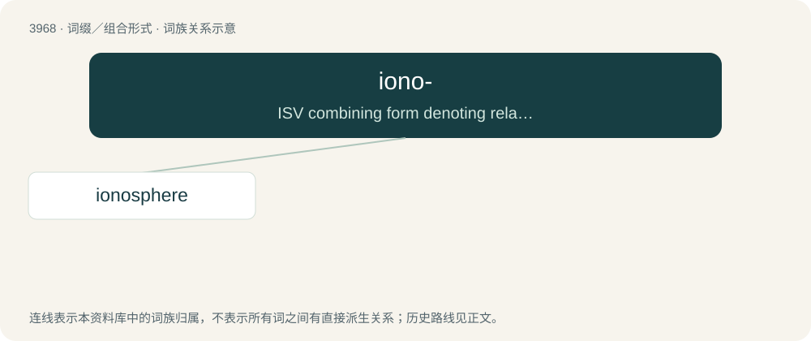

# 3993 · iono- — ISV combining form denoting relationship to ions

[总目录](../00_总目录_按常用程度.md)

**类型**：词缀／组合形式　｜　**来源语言**：见词源记录

## 核心含义与来源

- 核心含义：ISV combining form denoting relationship to ions
- 英文含义：ISV combining form denoting relationship to ions
- 词形：iono-

**来源记录 1**（前缀／前置成分；ISV combining form denoting relationship to ions）

From ion + -o-.

## 词族图

## 单词速览（常用到不常用）

| 单词 | 音标 | 释义 |
|---|---|---|
| [ionosphere](#w-1) | /aiˈɒnə.sfiə/ | n. 电离层；\[化\] 电离层 |

## 逐词详解

### 1. ionosphere

**词性**：名词　｜　**音标**：/aiˈɒnə.sfiə/

**中文释义**：n. 电离层；\[化\] 电离层

**英文义项**：The part of the Earth's atmosphere beginning at an altitude of about 50 kilometers (31 miles) and extending outward 500 kilometers (310 miles) or more. / The similar region of the atmosphere of another planet.

**构词拆分**：iono- + -sphere

**词源与演化**：

From iono- + -sphere.

**例句**：

> Solar radiation is what ionizes the ionosphere.
