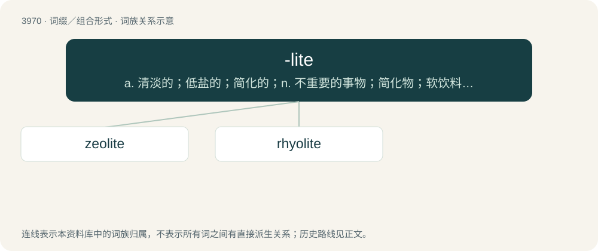

# 3995 · -lite — a. 清淡的；低盐的；简化的；n. 不重要的事物；简化物；软饮料；n. (Lite)人名；(法、西)利特

[总目录](../00_总目录_按常用程度.md)

**类型**：词缀／组合形式　｜　**来源语言**：见词源记录

## 核心含义与来源

- 核心含义：a. 清淡的；低盐的；简化的；n. 不重要的事物；简化物；软饮料；n. (Lite)人名；(法、西)利特
- 英文含义：Used to form the names of rocks and minerals.
- 词形：-lite

**来源记录 1**（后缀／后置成分；Used to form the names of rocks and minerals.）

Representing Ancient Greek λίθος (líthos, “stone”).

## 词族图

## 单词速览（常用到不常用）

| 单词 | 音标 | 释义 |
|---|---|---|
| [zeolite](#w-1) | /ˈziːəlait/ | n. 沸石；\[化\] 沸石 |
| [rhyolite](#w-2) | /ˈɹaɪ.əˌlaɪt/ | n. 流纹岩 |

## 逐词详解

### 1. zeolite

**词性**：名词　｜　**音标**：/ˈziːəlait/

**中文释义**：n. 沸石；\[化\] 沸石

**英文义项**：Any of several minerals, aluminosilicates of sodium, potassium, calcium or magnesium, that have a porous structure (originally, those which swelled and gave off water when heated); they are used in water softeners, in ion exchange chromatography, and as industrial catalysts.

**词源与演化**：

From Swedish zeolit, and its source, New Latin zeolites, from Ancient Greek ζέω (zéō, “to boil, bubble”) + -lite.

### 2. rhyolite

**词性**：名词　｜　**音标**：/ˈɹaɪ.əˌlaɪt/

**中文释义**：n. 流纹岩

**英文义项**：An igneous, volcanic (extrusive) rock, of felsic composition, with aphanitic to porphyritic texture.

**词源与演化**：

Coined by Ferdinand von Richthofen as German Rhyolith, from Ancient Greek ῥέω (rhéō, “flow”) + λίθος (líthos, “stone”) (modified to + -lite).
