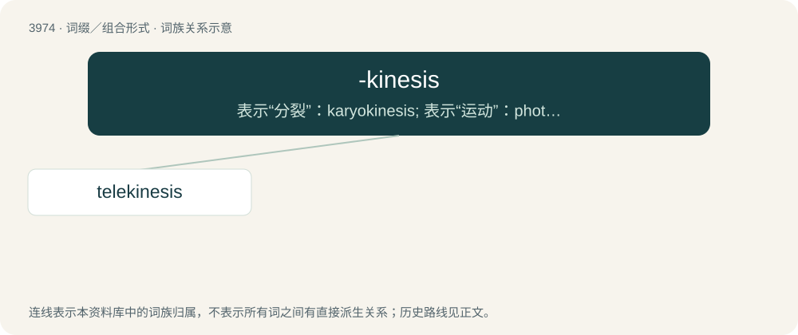

# 3997 · -kinesis — 表示“分裂”：karyokinesis; 表示“运动”：photokinesis

[总目录](../00_总目录_按常用程度.md)

**类型**：词缀／组合形式　｜　**来源语言**：见词源记录

## 核心含义与来源

- 核心含义：表示“分裂”：karyokinesis; 表示“运动”：photokinesis
- 英文含义：movement, motion
- 词形：-kinesis

**来源记录 1**（后缀／后置成分；movement, motion）

Borrowed from Ancient Greek κίνησις (kínēsis, “motion, movement”), from κινέω (kinéō, “I move, put in motion”).

## 词族图

## 单词速览（常用到不常用）

| 单词 | 音标 | 释义 |
|---|---|---|
| [telekinesis](#w-1) | /ˌtɛləkɪˈniːsɪs/ | n. 心灵致动, 心灵遥感；\[医\] 远距运动, 感应运动 |

## 逐词详解

### 1. telekinesis

**词性**：名词　｜　**音标**：/ˌtɛləkɪˈniːsɪs/

**中文释义**：n. 心灵致动, 心灵遥感；\[医\] 远距运动, 感应运动

**英文义项**：The ability to move objects, or otherwise interact with physical systems and other phenomena, through the power of one's mind. / An instance of use of such power.

**构词拆分**：tele- + -kinesis

**词源与演化**：

From tele- + -kinesis.

**例句**：

> Daniel finally began to realize he had the power of telekinesis.
