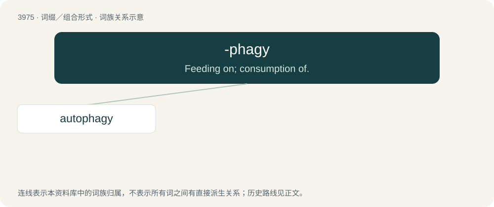

# 3998 · -phagy — Feeding on; consumption of.

[总目录](../00_总目录_按常用程度.md)

**类型**：词缀／组合形式　｜　**来源语言**：见词源记录

## 核心含义与来源

- 核心含义：Feeding on; consumption of.
- 英文含义：Feeding on; consumption of.
- 词形：-phagy

**来源记录 1**（后缀／后置成分；Feeding on; consumption of.）

From Ancient Greek -φαγία (-phagía), combining form of φαγεῖν (phageîn, “to eat”), infinitive aorist of ἐσθίω (esthíō, “I eat”).

## 词族图

## 单词速览（常用到不常用）

| 单词 | 音标 | 释义 |
|---|---|---|
| [autophagy](#w-1) | 美 /ɔˈtɑfəd͡ʒi/ | n. \[生\](细胞的)自我吞噬(作用) |

## 逐词详解

### 1. autophagy

**词性**：名词　｜　**音标**：美 /ɔˈtɑfəd͡ʒi/

**中文释义**：n. \[生\](细胞的)自我吞噬(作用)

**英文义项**：The process of self-digestion by a cell through the action of enzymes originating within the same cell, and often a defensive or self-preservation measure. / A type of programmed cell death accomplished through self-digestion.

**构词拆分**：auto- + -phagy

**词源与演化**：

From auto- + -phagy.
