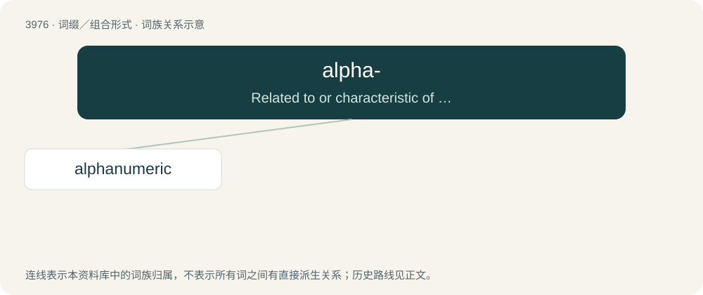

# 3999 · alpha- — Related to or characteristic of an alphabet or alphabetic characters.

[总目录](../00_总目录_按常用程度.md)

**类型**：词缀／组合形式　｜　**来源语言**：见词源记录

## 核心含义与来源

- 核心含义：Related to or characteristic of an alphabet or alphabetic characters.
- 英文含义：Related to or characteristic of an alphabet or alphabetic characters.
- 词形：alpha-

**来源记录 1**（前缀／前置成分；Related to or characteristic of an alphabet or alphabetic characters.）

From a shortening of alphabet.

## 词族图

## 单词速览（常用到不常用）

| 单词 | 音标 | 释义 |
|---|---|---|
| [alphanumeric](#w-1) | /ˌæl.fə.n(j)uːˈmɛ.ɹɪk/ | a. 字母数字的；\[计\] 字母数字的 |

## 逐词详解

### 1. alphanumeric

**词性**：形容词　｜　**音标**：/ˌæl.fə.n(j)uːˈmɛ.ɹɪk/

**中文释义**：a. 字母数字的；\[计\] 字母数字的

**英文义项**：Consisting of, or limited to, letters and/or numbers, especially the characters A to Z (lowercase and uppercase) and 0 to 9.

**构词拆分**：alpha- + numeric

**词源与演化**：

From alpha- + numeric.

**例句**：

> Batches are identified at the factory with an alphanumeric code.
