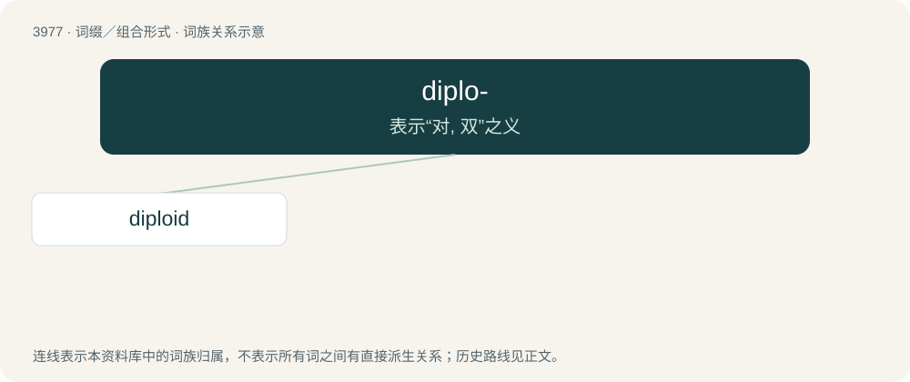

# 4000 · diplo- — 表示“对, 双”之义

[总目录](../00_总目录_按常用程度.md)

**类型**：词缀／组合形式　｜　**来源语言**：见词源记录

## 核心含义与来源

- 核心含义：表示“对, 双”之义
- 英文含义：double
- 词形：diplo-

**来源记录 1**（前缀／前置成分；double）

From international scientific vocabulary, reflecting a New Latin combining form, from Ancient Greek διπλόος (diplóos), διπλοῦς (diploûs, “double”).

## 词族图

## 单词速览（常用到不常用）

| 单词 | 音标 | 释义 |
|---|---|---|
| [diploid](#w-1) | 美 /ˈdɪploiːʔ/ | a. 双重的, 双倍的；n. 二倍体 |

## 逐词详解

### 1. diploid

**词性**：形容词　｜　**音标**：美 /ˈdɪploiːʔ/

**中文释义**：a. 双重的, 双倍的；n. 二倍体

**英文义项**：Of a cell, having a pair of each type of chromosome, one of the pair being derived from the ovum and the other from the spermatozoon. Most somatic cells of higher organisms are diploid. / Of an organism, having diploid cells.

**构词拆分**：diplo- + -oid

**词源与演化**：

From diplo- + -oid. By surface analysis, di- + -ploid.

**例句**：

> Male termites are diploid, unlike male hymenopterans.
