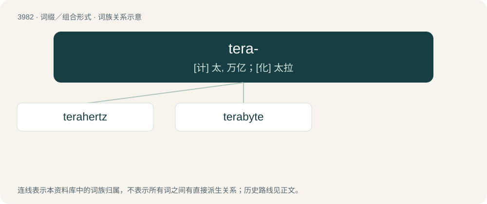

# 4004 · tera- — \[计\] 太, 万亿；\[化\] 太拉

[总目录](../00_总目录_按常用程度.md)

**类型**：词缀／组合形式　｜　**来源语言**：见词源记录

## 核心含义与来源

- 核心含义：\[计\] 太, 万亿；\[化\] 太拉
- 英文含义：In the International System of Units and other metric systems of units, multiplying the unit to which it is attached by 10¹² (short scale trillion or long scale billion).
- 词形：tera-

**来源记录 1**（前缀／前置成分；In the International System of Units and other metric systems of units, multiplying the unit to which it is attached by 10¹² (short scale trillion or long scale billion).）

From Ancient Greek τέρας (téras, “monster”). Also from Ancient Greek τέτταρες (téttares, “four”), by analogy with tetra- for being the fourth power of 10³. Doublet of terato-.

## 词族图

## 单词速览（常用到不常用）

| 单词 | 音标 | 释义 |
|---|---|---|
| [terahertz](#w-1) | /ˈterə,həːtz/ | \[电\] 兆赫 |
| [terabyte](#w-2) | /ˈtɛɹəˌbaɪt/ | \[计\] 太字节(万亿字节) |

## 逐词详解

### 1. terahertz

**词性**：名词　｜　**音标**：/ˈterə,həːtz/

**中文释义**：\[电\] 兆赫

**英文义项**：A unit of measurement based on one trillion hertz. / One trillion hertz, 10¹² Hz.

**构词拆分**：From tera- + hertz.

**词源与演化**：

From tera- + hertz.

### 2. terabyte

**词性**：名词　｜　**音标**：/ˈtɛɹəˌbaɪt/

**中文释义**：\[计\] 太字节(万亿字节)

**英文义项**：One trillion (10¹², or 1,000,000,000,000) bytes or 1,000 gigabytes. / A tebibyte.

**构词拆分**：tera- + byte

**词源与演化**：

From tera- + byte.

**例句**：

> The Terabyte Infrared Delivery (TBIRD) CubeSat payload will demonstrate laser downlinks at 200 Gbps – a new record for laser communications data rates.
