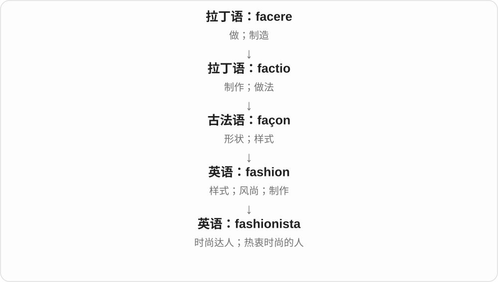

# 4005 · -ista — 某种活动、风格的追随者、参与者〔现代词尾〕

[逐词精讲目录](../00_逐词精讲目录.md) · [总目录](../00_总目录_按常用程度.md)

## 核心词根与来源

现代英语 -ista 的流行借受西班牙语 -ista 人物词尾、Sandinista 等名称影响；更深与 -ist 等学术人物词尾有历史联系。

**-ISTA：给某类人一个带风格色彩的称呼**

fashionista 是热衷时尚、熟悉穿搭潮流的人。词尾在这里形成一个人物称呼，常比普通 fashion lover 更有标签感。

- **热衷时尚的人**：fashionista

## 词形与演化规律

fashion 时尚 + -ista → fashionista。后部参与英语新造人物称呼，不表示这个人一定是西班牙人。

## 单词速览（按词族由简到繁）

同一基础词的相关扩展放在一起，先读基础形式，再读扩展；各组之间优先读常用的。具体词源关系见各词讲解。

| 单词 | 音标 | 核心意思 |
|---|---|---|
| [fashionista](#w-1) | /ˌfæ.ʃəˈnɪ.stə/ | 时尚达人；热衷时尚的人 |

## 逐词讲解

### 1. fashionista — 时尚达人；热衷时尚的人

**音标**：/ˌfæ.ʃəˈnɪ.stə/

**先抓住这个画面**

新品刚发布，她就知道设计、搭配和趋势，这类热衷时尚的人常被叫 fashionista。

**怎么拆**

fashion + 借自意大利语、西班牙语等的 -ista（某类人），现代英语构词。

**怎么变成今天的意思**

fashion 从流行样式变成兴趣与身份，后缀把这类人单独叫出来。口吻可以亲切、赞赏，也可以略带调侃。

**常见搭配与例句**

a local fashionista；fashionistas at the show。

> Fashionistas gathered outside the show.

时尚达人聚集在秀场外。

> You do not have to be a fashionista to enjoy good clothes.

不必是时尚达人，也可以享受好衣服。

**别混淆**

fashion designer 是设计师职业；fashionista 不一定从事设计工作。

## 这一组要分清什么

fashionista 可带欣赏、调侃等语气，需看上下文；不是所有时尚行业从业者的正式职称。

## 串起来练习

The magazine interviewed a local fashionista about vintage clothing.

杂志采访了一位本地时尚达人，请她谈复古服装。
