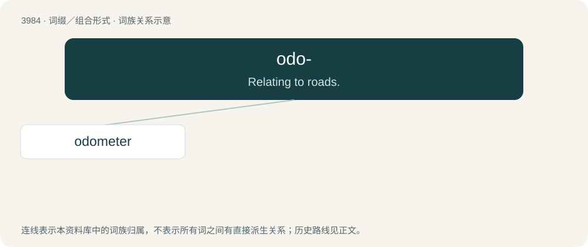

# 4007 · odo- — Relating to roads.

[总目录](../00_总目录_按常用程度.md)

**类型**：词缀／组合形式　｜　**来源语言**：见词源记录

## 核心含义与来源

- 核心含义：Relating to roads.
- 英文含义：Relating to roads.
- 词形：odo-

**来源记录 1**（前缀／前置成分；Relating to roads.）

From Ancient Greek ὁδός (hodós, “road, path, way”).

## 词族图

## 单词速览（常用到不常用）

| 单词 | 音标 | 释义 |
|---|---|---|
| [odometer](#w-1) | 英 /əʊˈdɒmətə/；美 /oʊˈdɑːmətɚ/ | n. 里程表 |

## 逐词详解

### 1. odometer

**词性**：名词　｜　**音标**：英 /əʊˈdɒmətə/；美 /oʊˈdɑːmətɚ/

**中文释义**：n. 里程表

**英文义项**：An instrument, usually embedded within the speedometer of a vehicle, that measures the distance the vehicle has traveled since production. / A wheel used by surveyors, which registers distance traveled.

**构词拆分**：odo- + -meter

**词源与演化**：

From French odomètre, from Ancient Greek ὁδός (hodós, “road, path, way”) + μέτρον (métron, “measure”), equivalent to odo- + -meter.

**例句**：

> Tom set his car's odometer back before selling it to an unsuspecting buyer.
