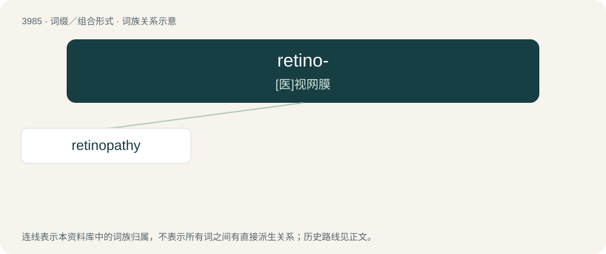

# 4008 · retino- — \[医\]视网膜

[总目录](../00_总目录_按常用程度.md)

**类型**：词缀／组合形式　｜　**来源语言**：见词源记录

## 核心含义与来源

- 核心含义：\[医\]视网膜
- 英文含义：retina
- 词形：retino-

## 词族图

## 单词速览（常用到不常用）

| 单词 | 音标 | 释义 |
|---|---|---|
| [retinopathy](#w-1) | /ˌɹɛtɪnˈɑːpəθi/ | \[医\] 视网膜病 |

## 逐词详解

### 1. retinopathy

**词性**：名词　｜　**音标**：/ˌɹɛtɪnˈɑːpəθi/

**中文释义**：\[医\] 视网膜病

**英文义项**：Non-inflammatory disease of the retina.

**构词拆分**：retino- + -pathy

**词源与演化**：

From retino- + -pathy.
