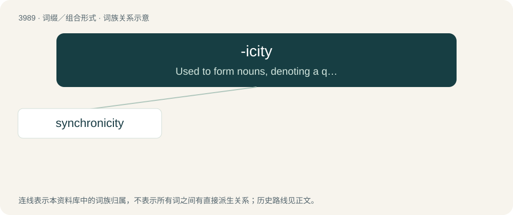

# 4012 · -icity — Used to form nouns, denoting a quality or condition, from adjectives, especially ones ending in -ic (in which case "ic" is not duplicated (see -ity)).

[总目录](../00_总目录_按常用程度.md)

**类型**：词缀／组合形式　｜　**来源语言**：见词源记录

## 核心含义与来源

- 核心含义：Used to form nouns, denoting a quality or condition, from adjectives, especially ones ending in -ic (in which case "ic" is not duplicated (see -ity)).
- 英文含义：Used to form nouns, denoting a quality or condition, from adjectives, especially ones ending in -ic (in which case "ic" is not duplicated (see -ity)).
- 词形：-icity

**来源记录 1**（后缀／后置成分；Used to form nouns, denoting a quality or condition, from adjectives, especially ones ending in -ic (in which case "ic" is not duplicated (see -ity)).）

From -ic + -ity.

## 词族图

## 单词速览（常用到不常用）

| 单词 | 音标 | 释义 |
|---|---|---|
| [synchronicity](#w-1) | /,siŋkrəˈnisəti,,sin-/ | n. \[心\]同步性,同时发生 |

## 逐词详解

### 1. synchronicity

**词性**：名词　｜　**音标**：/,siŋkrəˈnisəti,,sin-/

**中文释义**：n. \[心\]同步性,同时发生

**英文义项**：The state of being synchronous or simultaneous. / Coincidences that seem to be meaningfully related; supposedly the result of "universal forces".

**构词拆分**：synchron(ous) + -icity

**词源与演化**：

From synchron(ous) + -icity. From Jungian psychology in the 1920s. By surface analysis, syn- + chron- + -icity; historically, see synchronous § Etymology.
