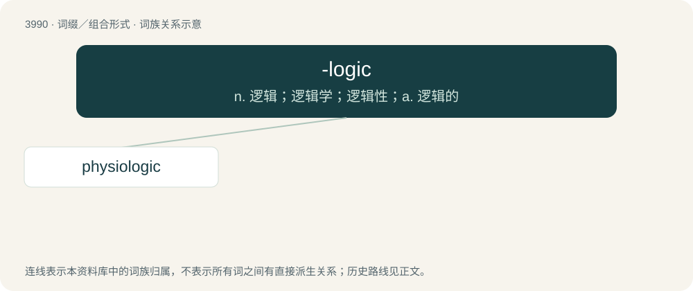

# 4013 · -logic — n. 逻辑；逻辑学；逻辑性；a. 逻辑的

[总目录](../00_总目录_按常用程度.md)

**类型**：词缀／组合形式　｜　**来源语言**：见词源记录

## 核心含义与来源

- 核心含义：n. 逻辑；逻辑学；逻辑性；a. 逻辑的
- 英文含义：-logical
- 词形：-logic

**来源记录 1**（后缀／后置成分；-logical）

Borrowed from French -logique. By surface analysis, -logy + -ic.

## 词族图

## 单词速览（常用到不常用）

| 单词 | 音标 | 释义 |
|---|---|---|
| [physiologic](#w-1) |  | a. 生理学的, 生理的；\[医\] 生理学的, 生理的 |

## 逐词详解

### 1. physiologic

**词性**：形容词

**中文释义**：a. 生理学的, 生理的；\[医\] 生理学的, 生理的

**英文义项**：Of or pertaining to physiology.

**构词拆分**：physio- + -logic

**词源与演化**：

Either from physio- + -logic or Latin physiologicus.
