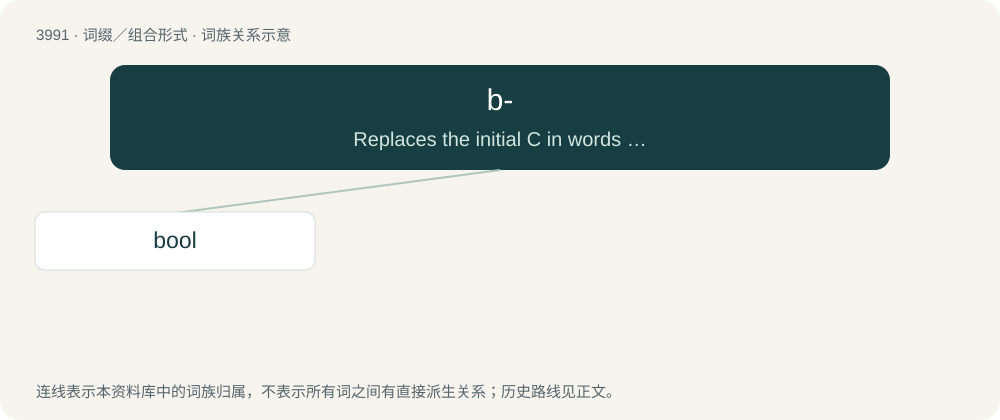

# 4014 · b- — Replaces the initial C in words to avoid association with the Crips.

[总目录](../00_总目录_按常用程度.md)

**类型**：词缀／组合形式　｜　**来源语言**：见词源记录

## 核心含义与来源

- 核心含义：Replaces the initial C in words to avoid association with the Crips.
- 英文含义：Replaces the initial C in words to avoid association with the Crips.
- 词形：b-

## 词族图

## 单词速览（常用到不常用）

| 单词 | 音标 | 释义 |
|---|---|---|
| [bool](#w-1) |  | 【英文】To relax or hang out (especially with someone). |

## 逐词详解

### 1. bool

**词性**：动词

**英文义项**：To relax or hang out (especially with someone).

**构词拆分**：b- + (c)ool

**词源与演化**：

From b- + (c)ool, likely originally (or in imitation of) Blood slang.

**例句**：

> I'm going to go bool with the boys.

该用例对应义项：To relax or hang out (especially with someone).
