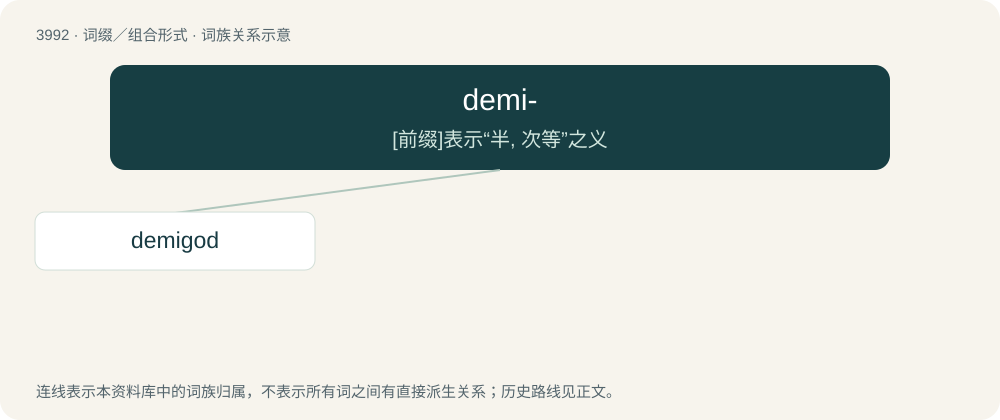

# 4015 · demi- — \[前缀\]表示“半, 次等”之义

[总目录](../00_总目录_按常用程度.md)

**类型**：词缀／组合形式　｜　**来源语言**：见词源记录

## 核心含义与来源

- 核心含义：\[前缀\]表示“半, 次等”之义
- 英文含义：partial
- 词形：demi-

**来源记录 1**（前缀／前置成分；partial）

From Middle English demi (“half, half-sized, partial”), from Anglo-Norman demi (“half”), from Vulgar Latin \*dimedius, from Latin dīmidius, from dis- (“apart; in two”) + medius (“middle”).

## 词族图

## 单词速览（常用到不常用）

| 单词 | 音标 | 释义 |
|---|---|---|
| [demigod](#w-1) | 英 /ˈdɛmiɡɒd/；美 /ˈdɛmiɡɑd/ | n. 半神半人, 小神, 受崇拜的人 |

## 逐词详解

### 1. demigod

**词性**：名词　｜　**音标**：英 /ˈdɛmiɡɒd/；美 /ˈdɛmiɡɑd/

**中文释义**：n. 半神半人, 小神, 受崇拜的人

**英文义项**：A half-god or hero; the offspring of a deity and a mortal. / Someone held up for reverence as a supreme example.

**构词拆分**：demi- + god

**词源与演化**：

From demi- + god. Calque of the Latin semideus (“half-god”), which is probably a coining by the Roman poet Ovid for less important gods such as dryads.

**例句**：

> Elvis Costello is a demigod of new wave music.
