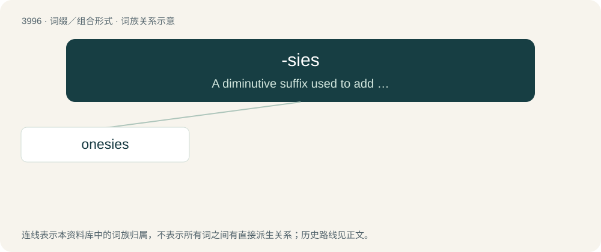

# 4018 · -sies — A diminutive suffix used to add an element of childishness, informality, affectionateness, or levity to a word.

[总目录](../00_总目录_按常用程度.md)

**类型**：词缀／组合形式　｜　**来源语言**：见词源记录

## 核心含义与来源

- 核心含义：A diminutive suffix used to add an element of childishness, informality, affectionateness, or levity to a word.
- 英文含义：A diminutive suffix used to add an element of childishness, informality, affectionateness, or levity to a word.
- 词形：-sies

**来源记录 1**（后缀／后置成分；A diminutive suffix used to add an element of childishness, informality, affectionateness, or levity to a word.）

From -s (plural marker) + -y (diminutive marker) + -s (plural marker).

## 词族图

## 单词速览（常用到不常用）

| 单词 | 音标 | 释义 |
|---|---|---|
| [onesies](#w-1) |  | 【英文】A call in any children's game, such as jacks, where one action must be performed. |

## 逐词详解

### 1. onesies

**词性**：名词

**英文义项**：A call in any children's game, such as jacks, where one action must be performed.

**构词拆分**：one + -sies

**词源与演化**：

From one + -sies.

**例句**：

> I don't find it weird that Tom likes wearing onesies.
