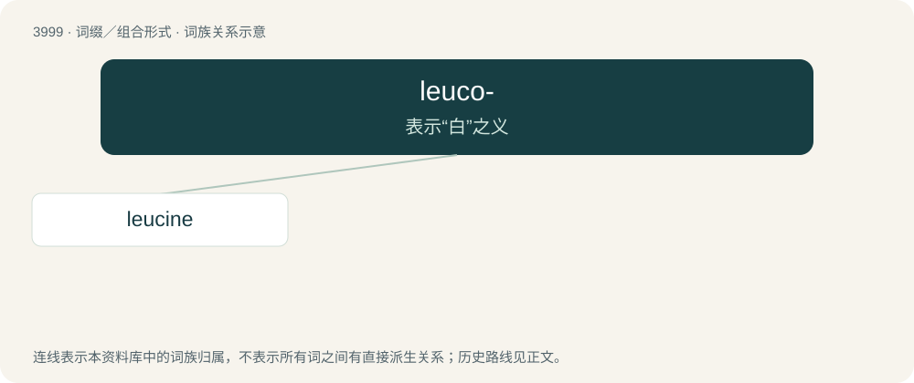

# 4020 · leuco- — 表示“白”之义

[总目录](../00_总目录_按常用程度.md)

**类型**：词缀／组合形式　｜　**来源语言**：见词源记录

## 核心含义与来源

- 核心含义：表示“白”之义
- 英文含义：Latinized Alternative spelling of leuko- (“white; colourless; leucocyte”).
- 词形：leuco-

**来源记录 1**（前缀／前置成分；Latinized Alternative spelling of leuko- (“white; colourless; leucocyte”).）

From Latinized form of Ancient Greek λευκός (leukós, “white”).

## 词族图

## 单词速览（常用到不常用）

| 单词 | 音标 | 释义 |
|---|---|---|
| [leucine](#w-1) | /ˈluː.siːn/ | n. 白氨酸；\[化\] 亮氨酸; 白氨酸; 异己氨酸 |

## 逐词详解

### 1. leucine

**词性**：名词　｜　**音标**：/ˈluː.siːn/

**中文释义**：n. 白氨酸；\[化\] 亮氨酸; 白氨酸; 异己氨酸

**英文义项**：An essential amino acid, C₆H₁₃NO₂, isomeric with isoleucine, found in most animal proteins; it is essential for growth in children.

**构词拆分**：leuco- + -ine

**词源与演化**：

Derived from Ancient Greek λευκός (leukós, “white”) + -ine, equivalent to leuco- + -ine.
