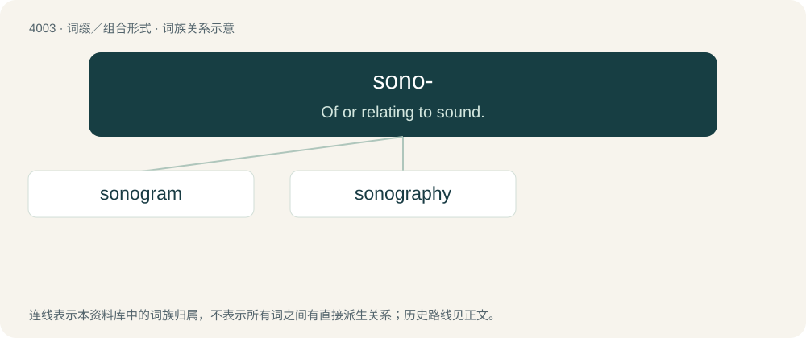

# 4024 · sono- — Of or relating to sound.

[总目录](../00_总目录_按常用程度.md)

**类型**：词缀／组合形式　｜　**来源语言**：见词源记录

## 核心含义与来源

- 核心含义：Of or relating to sound.
- 英文含义：Of or relating to sound.
- 词形：sono-

**来源记录 1**（前缀／前置成分；Of or relating to sound.）

From Latin sonus (“sound”).

## 词族图

## 单词速览（常用到不常用）

| 单词 | 音标 | 释义 |
|---|---|---|
| [sonogram](#w-1) | 英 /ˈsəʊ.nəˌɡɹæm/；美 /ˈsɑnəˌɡɹæm/ | 语图 |
| [sonography](#w-2) | /səˈnɔ^rəfi/ | n. \[医\]超声波检查法, 超声波扫描术 |

## 逐词详解

### 1. sonogram

**词性**：名词　｜　**音标**：英 /ˈsəʊ.nəˌɡɹæm/；美 /ˈsɑnəˌɡɹæm/

**中文释义**：语图

**英文义项**：A spectrogram.

**构词拆分**：Latin sonus (“sound”) + -gram；sono- + -gram

**词源与演化**：

From Latin sonus (“sound”) + -gram, equivalent to sono- + -gram.

### 2. sonography

**词性**：名词　｜　**音标**：/səˈnɔ^rəfi/

**中文释义**：n. \[医\]超声波检查法, 超声波扫描术

**英文义项**：night writing

**构词拆分**：sono- + -graphy

**词源与演化**：

From sono- + -graphy.
