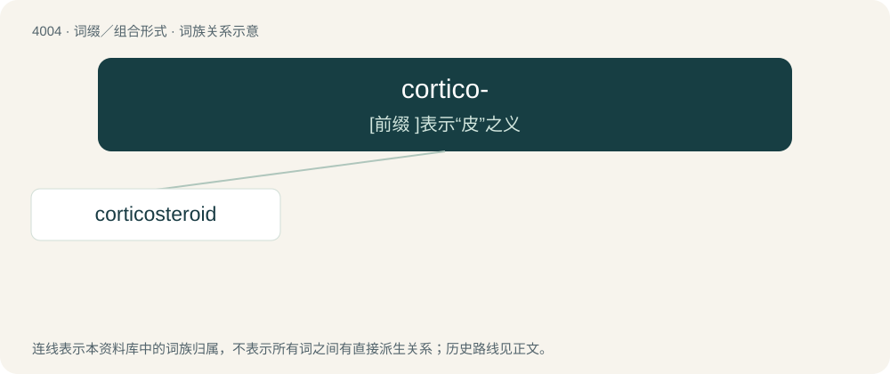

# 4025 · cortico- — \[前缀 \]表示“皮”之义

[总目录](../00_总目录_按常用程度.md)

**类型**：词缀／组合形式　｜　**来源语言**：见词源记录

## 核心含义与来源

- 核心含义：\[前缀 \]表示“皮”之义
- 英文含义：cortex, usually the adrenal cortex or the cerebral cortex.
- 词形：cortico-

**来源记录 1**（前缀／前置成分；cortex, usually the adrenal cortex or the cerebral cortex.）

Derived from Latin cortex (“bark”).

## 词族图

## 单词速览（常用到不常用）

| 单词 | 音标 | 释义 |
|---|---|---|
| [corticosteroid](#w-1) | 美 /ˈkʰoɹɾɪko.steːɹoid/ | n. 皮质类固醇；\[医\] 皮质甾(类)(化学), 皮质类固醇(生化) |

## 逐词详解

### 1. corticosteroid

**词性**：名词　｜　**音标**：美 /ˈkʰoɹɾɪko.steːɹoid/

**中文释义**：n. 皮质类固醇；\[医\] 皮质甾(类)(化学), 皮质类固醇(生化)

**英文义项**：Any of a group of steroid hormones, secreted by the adrenal cortex, that are involved in a large range of physiological systems. / Any of several synthetic hormones of related structure.

**构词拆分**：cortico- + steroid

**词源与演化**：

From cortico- + steroid.

**例句**：

> It's not an anabolic steroid, but a corticosteroid.
