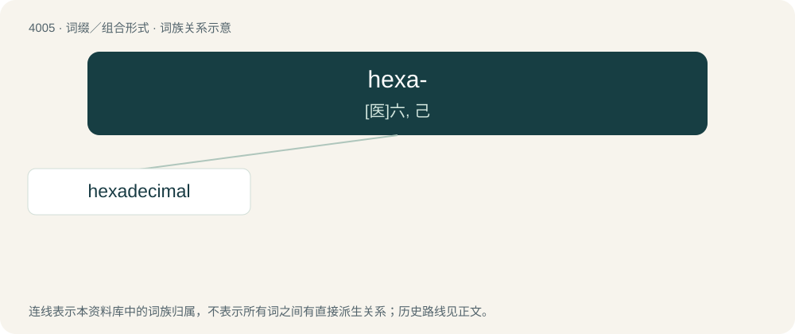

# 4026 · hexa- — \[医\]六, 己

[总目录](../00_总目录_按常用程度.md)

**类型**：词缀／组合形式　｜　**来源语言**：见词源记录

## 核心含义与来源

- 核心含义：\[医\]六, 己
- 英文含义：Six.
- 词形：hexa-

**来源记录 1**（前缀／前置成分；Six.）

From Latin hexa-, from Ancient Greek ἑξα- (hexa-), from ἕξ (héx, “six”). By surface analysis, hex- + -a-. Piecewise doublet of sexa-.

## 词族图

## 单词速览（常用到不常用）

| 单词 | 音标 | 释义 |
|---|---|---|
| [hexadecimal](#w-1) | /ˌhɛksəˈdɛsɪməl/ | a. 十六进制的；n. 十六进制；\[计\] 十六进制 |

## 逐词详解

### 1. hexadecimal

**词性**：名词　｜　**音标**：/ˌhɛksəˈdɛsɪməl/

**中文释义**：a. 十六进制的；n. 十六进制；\[计\] 十六进制

**英文义项**：A number system with base sixteen, using the digits 0, 1, 2, 3, 4, 5, 6, 7, 8, 9, A, B, C, D, E and F, most used in computing as a hexadecimal digit can represent four bits, half a standard byte, and thus a single byte can be represented conveniently with two digits. / A number expressed in the hexadecimal system.

**构词拆分**：hexa- + decimal

**词源与演化**：

1952, from hexa- + decimal; see the Wikipedia article for more information. Piecewise doublet of sexadecimal.

**例句**：

> F in hexadecimal is equal to 15.
