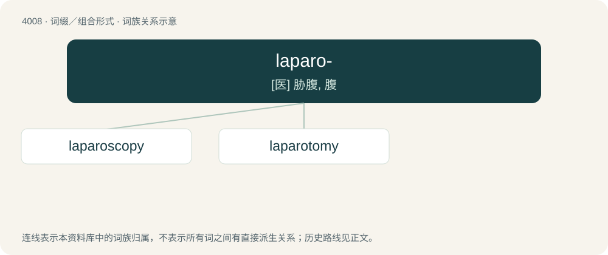

# 4027 · laparo- — \[医\] 胁腹, 腹

[总目录](../00_总目录_按常用程度.md)

**类型**：词缀／组合形式　｜　**来源语言**：见词源记录

## 核心含义与来源

- 核心含义：\[医\] 胁腹, 腹
- 英文含义：flank, side
- 词形：laparo-

**来源记录 1**（前缀／前置成分；flank, side）

Combining form of Ancient Greek λαπάρα (lapára, “flank”), from λαπαρός (laparós, “slack, weak, hollow”).

## 词族图

## 单词速览（常用到不常用）

| 单词 | 音标 | 释义 |
|---|---|---|
| [laparoscopy](#w-1) | 英 /lapəˈɹɒskəpi/ | \[医\] 腹腔镜检查 |
| [laparotomy](#w-2) | /.læpəˈrɒtəmi/ | n. 剖腹手术；\[医\] 剖腹术 |

## 逐词详解

### 1. laparoscopy

**词性**：名词　｜　**音标**：英 /lapəˈɹɒskəpi/

**中文释义**：\[医\] 腹腔镜检查

**英文义项**：Examination of the loins or abdomen, now specifically examination or surgery on the peritoneal cavity using a laparoscope.

**构词拆分**：laparo- (“flank”) + -scopy

**词源与演化**：

From laparo- (“flank”) + -scopy, after German Laparoskopie.

### 2. laparotomy

**词性**：名词　｜　**音标**：/.læpəˈrɒtəmi/

**中文释义**：n. 剖腹手术；\[医\] 剖腹术

**英文义项**：The surgical procedure for making an incision in the abdominal wall to gain access into the abdominal cavity. Performed either as exploratory surgery, or as the first step in an abdominal operation.

**构词拆分**：laparo- + -tomy

**词源与演化**：

From laparo- + -tomy.
