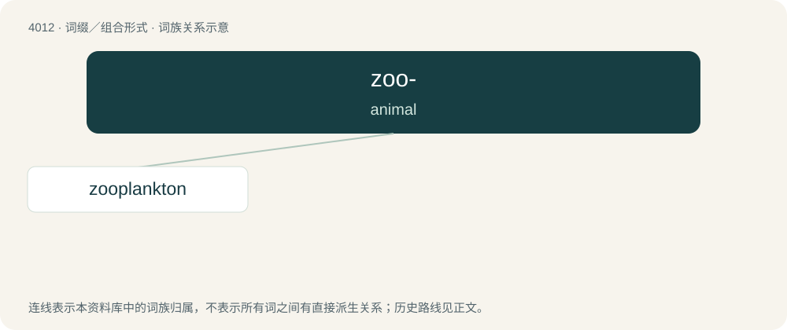

# 4029 · zoo- — animal

[总目录](../00_总目录_按常用程度.md)

**类型**：词缀／组合形式　｜　**来源语言**：见词源记录

## 核心含义与来源

- 核心含义：animal
- 英文含义：animal
- 词形：zoo-

**来源记录 1**（前缀／前置成分；animal）

From (combining form of) Ancient Greek ζῷον (zōîon, “animal”).

## 词族图

## 单词速览（常用到不常用）

| 单词 | 音标 | 释义 |
|---|---|---|
| [zooplankton](#w-1) | 英 /ˈzəʊ.ə.plaŋ(k).tən/；美 /ˌzoʊ.əˈplæŋ(k).tən/ | \[医\] 浮游动物 |

## 逐词详解

### 1. zooplankton

**词性**：名词　｜　**音标**：英 /ˈzəʊ.ə.plaŋ(k).tən/；美 /ˌzoʊ.əˈplæŋ(k).tən/

**中文释义**：\[医\] 浮游动物

**英文义项**：Free-floating small protozoa, crustaceans (such as krill), etc. and the eggs and larvae from larger animals.

**构词拆分**：zoo- + plankton

**词源与演化**：

From zoo- + plankton.
