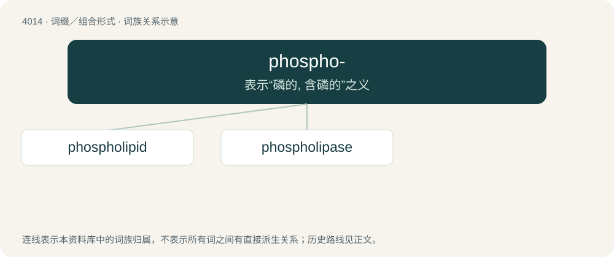

# 4031 · phospho- — 表示“磷的, 含磷的”之义

[总目录](../00_总目录_按常用程度.md)

**类型**：词缀／组合形式　｜　**来源语言**：见词源记录

## 核心含义与来源

- 核心含义：表示“磷的, 含磷的”之义
- 英文含义：phosphorus
- 词形：phospho-

**来源记录 1**（前缀／前置成分；phosphorus）

From phosphorus.

## 词族图

## 单词速览（常用到不常用）

| 单词 | 音标 | 释义 |
|---|---|---|
| [phospholipid](#w-1) | 美 /ˌfɑs.foʊˈlɪ.pɪd/ | n. 磷脂体, 膦脂类；\[化\] 磷脂 |
| [phospholipase](#w-2) | /,fɔsfəuˈlaipeis/ | n. \[生化\]磷脂酶 |

## 逐词详解

### 1. phospholipid

**词性**：名词　｜　**音标**：美 /ˌfɑs.foʊˈlɪ.pɪd/

**中文释义**：n. 磷脂体, 膦脂类；\[化\] 磷脂

**英文义项**：Any lipid, such as lecithin or cephalin, consisting of a diglyceride combined with a phosphate group and a simple organic molecule such as choline or ethanolamine; they are important constituents of biological membranes.

**构词拆分**：phospho- + lipid

**词源与演化**：

From phospho- + lipid.

### 2. phospholipase

**词性**：名词　｜　**音标**：/,fɔsfəuˈlaipeis/

**中文释义**：n. \[生化\]磷脂酶

**英文义项**：Any of several enzymes that hydrolyze the phosphate ester bonds of phospholipids.

**构词拆分**：phospho- + lipase

**词源与演化**：

From phospho- + lipase.
