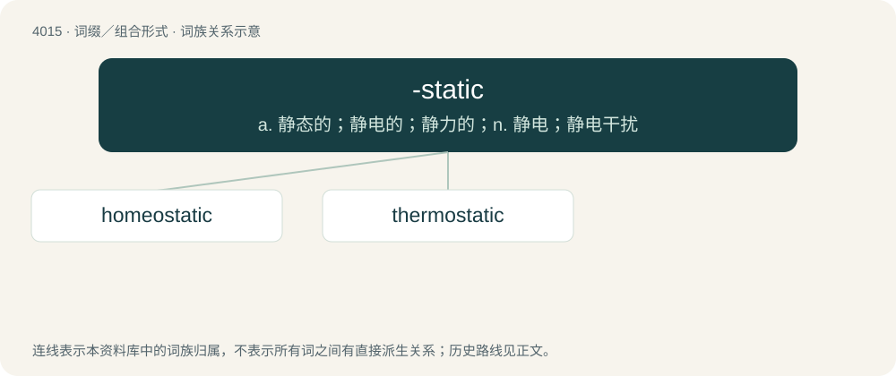

# 4032 · -static — a. 静态的；静电的；静力的；n. 静电；静电干扰

[总目录](../00_总目录_按常用程度.md)

**类型**：词缀／组合形式　｜　**来源语言**：见词源记录

## 核心含义与来源

- 核心含义：a. 静态的；静电的；静力的；n. 静电；静电干扰
- 英文含义：used in adjectives relating to nouns with the suffix -stasis
- 词形：-static

## 词族图

## 单词速览（常用到不常用）

| 单词 | 音标 | 释义 |
|---|---|---|
| [homeostatic](#w-1) | 美 /ˌhoʊmioʊˈstætɪk/ | a. 体内平衡, 内环境稳定；\[医\] 内环境稳定的 |
| [thermostatic](#w-2) | /.θəːməuˈstætik/ | a. 趋温性的, 体温调节的 |

## 逐词详解

### 1. homeostatic

**词性**：形容词　｜　**音标**：美 /ˌhoʊmioʊˈstætɪk/

**中文释义**：a. 体内平衡, 内环境稳定；\[医\] 内环境稳定的

**英文义项**：Of or pertaining to homeostasis.

**构词拆分**：homeo- + -static

**词源与演化**：

From homeo- + -static.

**例句**：

> Multicellular organisms require a homeostatic internal environment in order to live.

该用例对应义项：Of or pertaining to homeostasis.

### 2. thermostatic

**词性**：形容词　｜　**音标**：/.θəːməuˈstætik/

**中文释义**：a. 趋温性的, 体温调节的

**英文义项**：having or maintaining a consistent temperature / Relating to thermostasis

**构词拆分**：thermo- + -static

**词源与演化**：

From thermo- + -static.

**例句**：

> The shower has a thermostatic water-mixing valve.

该用例对应义项：having or maintaining a consistent temperature
