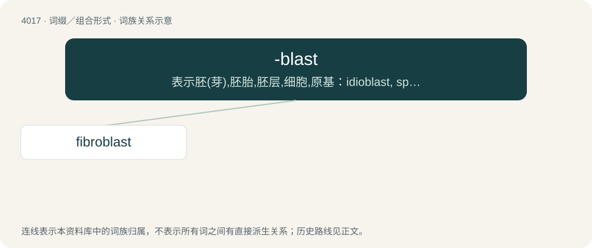

# 4034 · -blast — 表示胚(芽),胚胎,胚层,细胞,原基：idioblast, splanchnoblast(内脏原基)

[总目录](../00_总目录_按常用程度.md)

**类型**：词缀／组合形式　｜　**来源语言**：见词源记录

## 核心含义与来源

- 核心含义：表示胚(芽),胚胎,胚层,细胞,原基：idioblast, splanchnoblast(内脏原基)
- 英文含义：an immature cell or tissue
- 词形：-blast

**来源记录 1**（后缀／后置成分；an immature cell or tissue）

Borrowed from Ancient Greek βλᾰστός (blăstós, “germ, sprout”).

## 词族图

## 单词速览（常用到不常用）

| 单词 | 音标 | 释义 |
|---|---|---|
| [fibroblast](#w-1) | 英 /ˈfaɪ.brəˌblɑːst/；美 /ˈfaɪ.brəˌblæst/ | n. 成纤维细胞；\[医\] 成纤维细胞, 纤维细胞 |

## 逐词详解

### 1. fibroblast

**词性**：名词　｜　**音标**：英 /ˈfaɪ.brəˌblɑːst/；美 /ˈfaɪ.brəˌblæst/

**中文释义**：n. 成纤维细胞；\[医\] 成纤维细胞, 纤维细胞

**英文义项**：A cell found in connective tissue that produces fibers, such as collagen.

**构词拆分**：fibro- + -blast

**词源与演化**：

From fibro- + -blast.
