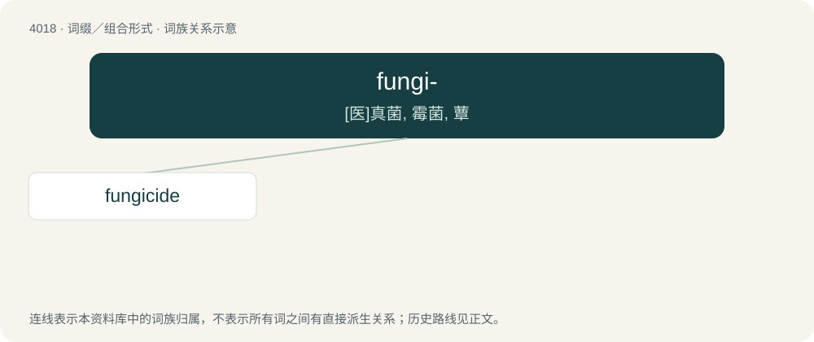

# 4035 · fungi- — \[医\]真菌, 霉菌, 蕈

[总目录](../00_总目录_按常用程度.md)

**类型**：词缀／组合形式　｜　**来源语言**：见词源记录

## 核心含义与来源

- 核心含义：\[医\]真菌, 霉菌, 蕈
- 英文含义：Fungus, fungi: mushrooms, yeasts, molds, and so on.
- 词形：fungi-

**来源记录 1**（前缀／前置成分；Fungus, fungi: mushrooms, yeasts, molds, and so on.）

From the compound form of Latin fungus, from fungus (“mushroom”) + -i- (compound word interfix).

## 词族图

## 单词速览（常用到不常用）

| 单词 | 音标 | 释义 |
|---|---|---|
| [fungicide](#w-1) | /ˈfʌŋɡɪsaɪd/ | n. 杀真菌剂；\[化\] 杀菌剂; 防霉剂 |

## 逐词详解

### 1. fungicide

**词性**：名词　｜　**音标**：/ˈfʌŋɡɪsaɪd/

**中文释义**：n. 杀真菌剂；\[化\] 杀菌剂; 防霉剂

**英文义项**：A substance used to kill fungus, whether yeasts, molds, mildews, or mushrooms.

**构词拆分**：fungi- + -cide

**词源与演化**：

From fungi- + -cide.
